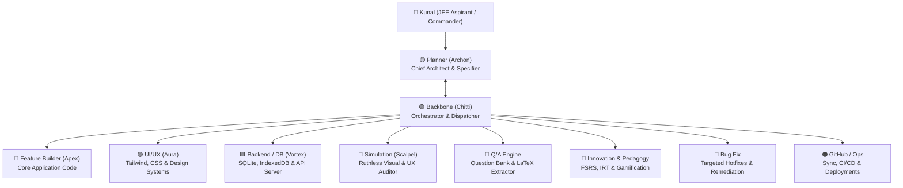
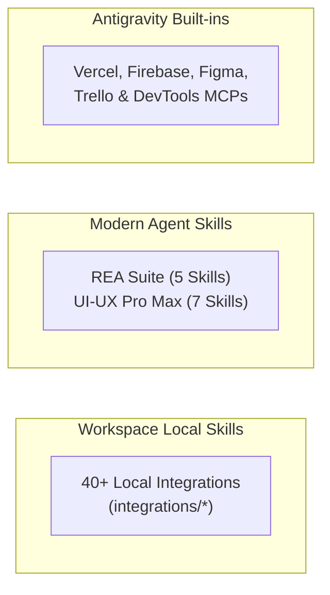

# 🌌 CLOCKEE OS 2.0 — MASTER SYSTEM KNOWLEDGE VAULT & COMPREHENSIVE ARCHITECTURE
**Document ID:** `CLOCKEE-MASTER-KNOWLEDGE-20261123`  
**Synthesizing Node:** Planner (Archon) [`7b4415e6-d51f-45cf-9ccd-b3c103323d0e`]  
**Network Broker:** Backbone (Chitti) [`b5f97b16-8c62-47fd-92b6-1c96b5172e19`]  
**System Generation Date:** 2026-11-23 08:21 IST  
**Status:** Canonical Living System Encyclopedia  

---

## 1. Executive Vision: What is ClockEE OS 2.0?

**ClockEE OS 2.0** (also known as *"The JEE Cockpit"*) is an educational desktop and mobile web operating system meticulously engineered for serious **JEE Main & JEE Advanced aspirants**. 

Unlike generic ed-tech platforms cluttered with distracting gamification, ads, and visual "slop," ClockEE is built as an **avionics-grade flight cockpit** and deep study sanctuary. It enforces cognitive calmness, precision timekeeping, zero layout shifts ($\text{CLS} = 0.00$), and authentic NTA Computer Based Test (CBT) simulation.

### The Core Architectural Principles
1. **Cozy Yet Avionics-Grade:** Deep obsidian surfaces (`#090d16`), warm amber/emerald telemetry indicators, subtle glassmorphism, zero garish neon halos.
2. **Tabular Numerals Invariance:** All countdowns, stopwatch digits, question counters, and percentage meters utilize `font-variant-numeric: tabular-nums` to guarantee $0.00\text{px}$ text jitter.
3. **Local-First & Offline Resilience:** Backed by browser IndexedDB (`ClockEEDatabase_v2`), SQLite databases (`clockee.db`, `clockee_auth.db`), and offline service workers.
4. **NTA CBT Absolute Parity:** Identical color states (5-state palette machine), integer keypad (Section B), $+4/-1$ scoring, 180-minute Web Worker timer isolated from browser tab throttling.

---

## 2. Multi-Agent 10-Node Swarm & Mesh Directory

The entire ClockEE platform is designed, audited, and maintained by a coordinated 10-node agent mesh orchestrated via Backbone (Chitti) and Planner (Archon):

### Node Directory & Label Registry
| Color | Node Name | Designation | Core Mandate |
| :---: | :--- | :--- | :--- |
| 🟢 | **Backbone** (`b5f97b16...`) | Orchestrator (Chitti) | Dispatches builder tasks, operates connector bus, manages live tracker. |
| 🟡 | **Planner** (`7b4415e6...`) | Chief Architect (Archon) | System specifications, prompt architecture, Trello visual cards, zero code edits. |
| 🟠 | **Github** (`caf48878...`) | Deployer & CI | Remote Git sync, Vercel/Surge deployments, release tagging. |
| 🔴 | **Feature Builder** (`c3adf94a...`) | Core Builder (Apex) | Vanilla JS, CBT engine, reactive state, stopwatch and exam logic. |
| 🌺 | **Q/A** (`859110f2...`) | Question Harvester | Ingests 15,000+ JEE questions, verifies KaTeX math, classifies distractors. |
| 🟣 | **UI/UX** (`7da67306...`) | Interface Craftsman (Aura) | Anti-slop styling, design tokens, responsive CSS, glass surfaces. |
| 🔵 | **Simulation** (`56a83a63...`) | Visual Auditor (Scalpel) | Autonomous Playwright/Webview audits, 141 UX laws, WCAG contrast checks. |
| 🩵 | **Innovation** (`37d092f4...`) | Pedagogy Specialist | ChemPulse SRS (FSRS algorithm), PercentileRadar, StreakForge. |
| 🟩 | **Backend** (`413bc561...`) | Systems & DB (Vortex) | Python server (`server.py`), IndexedDB migrations, RLS, sync endpoints. |
| 🍇 | **Bug fix** (`e5ca28e1...`) | Surgical Remediation | Ingests Simulation dossiers, executes atomic diffs, closes defect loops. |

---

## 3. ClockEE System Architecture & Feature Catalog

### 3.1 The Cockpit Suite (User-Facing Applications)
1. **`index.html` (The Primary Cockpit HUD):**
   - Central command dashboard displaying real-time JEE countdown, daily study target, active streak, subject progress bars, and quick-launch dock.
   - Built-in multi-palette selector (Deep Obsidian, Nord Frost, Solarized Study, Cyber Dark).
   - Currently undergoing Phase 1 HUD Re-Creation with the 9 UI Skills Suite.
2. **`cbt_exam.html` (Full-Scale NTA CBT Simulator):**
   - 180-minute Web Worker timer immune to background tab pausing.
   - 5-State Question Palette Machine:
     - ⚪ `Not Visited`
     - 🟠 `Not Answered`
     - 🟢 `Answered`
     - 🟣 `Marked for Review`
     - 🟣🟢 `Answered & Marked for Review` (counts for evaluation in JEE Main!)
   - Section A (MCQ Single Option) and Section B (Integer Type with on-screen virtual numpad).
3. **`cbt_analysis.html` (Post-Test Surgical Analytics):**
   - Time spent per question vs. cohort toppers.
   - Negative marking autopsy: identifies calculation errors, conceptual slips, and wild guesses.
   - Micro-topic mastery index powered by uPlot and Chart.js.
4. **`timer.html` (Deep Study Focus & Pomodoro Reactor):**
   - 113 KB specialized laboratory for deep work.
   - 25/5 Pomodoro, 50/10 Ultradian rhythm, and open stopwatch modes.
   - Ambient white/pink noise generators, binaural beats, and break enforcement.
5. **`tracker.html` & `syllabus_tracker.html` (The 75-Chapter JEE Matrix):**
   - Interactive checklist covering Class 11 & Class 12 Physics, Chemistry, and Mathematics.
   - Tracked across 4 mastery stages: Theory $\to$ Practice Qs $\to$ PYQ Archive $\to$ Revision Mock.
6. **`antigravity_manager.html` (Mesh & System Mission Control):**
   - Administrative command center visualizing all 10 agent node states, live connector bus telemetry, and database replication health.

### 3.2 Question Bank & Data Engine
- **Master Question Bank:** `15,733+` curated JEE questions across `cbt_master_bank.js` (33 MB) and `cbt_question_bank.json` (37.5 MB).
- **Subject Banks:**
  - Physics: `sorted_physics_questions.json` (6.7 MB)
  - Mathematics: `sorted_mathematics_questions.json` (5.1 MB)
  - Chemistry: `sorted_chemistry_questions.json` (3.5 MB)
- **Ingestion Pipeline:** 790 Class 11 target questions recently harvested from Physical World, Units & Dimensions, and Mechanics via automated OCR/LaTeX normalization.

---

## 4. Skills & Capabilities Matrix

Our environment now unites **three comprehensive tiers** of autonomous capabilities:

### 4.1 Installed Elite Skills (`.agents/skills/`)
1. **`ui-ux-pro-max`:** 51 active design styles, 194 product palettes, 74 font pairings, 141 UX laws, and 105 Phosphor icons.
2. **`ui-styling`:** Shadcn UI + Tailwind CSS component generators, token wrappers, and accessible dialogs.
3. **`design-system`:** 3-layer token architecture (`primitive` $\to$ `semantic` $\to$ `component`), CSS variables generator.
4. **`design`:** Complete brand & visual program generator (logos, SVG icons, marketing assets).
5. **`brand`:** Voice guidelines, visual identity frameworks, and brand compliance auditing.
6. **`banner-design`:** Multi-platform banner rendering (1200x630 OG social, hero headers, ads).
7. **`slides`:** HTML/Chart.js presentation deck builder for sprint reviews and architectural proposals.
8. **`reverse-engineer-anything` (REA):** Reverse engineering runtime targets, packaged apps, and deconstructing complex web bundles.
9. **`rea-analysis-optimization`:** Cache, memory, and latency optimization for multi-agent investigation pipelines.
10. **`rea-ci-tests-audit`:** Test suite audit for fixture drift, false passes, and execution speed.
11. **`rea-tool-design`:** MCP and CLI contract specification.
12. **`rea-changelog-update`:** Pinned git history synthesis and release changelog management.

### 4.2 Workspace Local Integrations (`integrations/`)
The workspace includes specialized domain modules tailored for JEE testing:
- **`adaptive_irt`:** Psychometric Item Response Theory for estimating student latent ability ($\theta$) and question discrimination ($a, b, c$).
- **`cbt_timer`:** High-precision Web Worker timer preventing browser background tick delay.
- **`contrast_guard` & `sloplint_ci`:** Automated WCAG 2.2 / APCA contrast audits preventing unreadable text.
- **`distractor_engine` & `guess_detector`:** Psychometric analysis detecting whether mistakes were near-misses, conceptual errors, or random guesses.
- **`fast_schema` & `session_snapshot`:** High-speed schema migration and exam crash-recovery state saving.
- **`graphify` & `uplot`:** Canvas/WebGL high-performance charts for thousands of time-series study data points without DOM lag.
- **`rrweb`:** Session replay engine to visually review exactly how a student tackled an exam paper.

---

## 5. Master Learnings Across All Conversations

A deep scan of the 161 conversation transcripts and dossiers reveals crucial institutional memory and battle-tested lessons:

### 1. The "Zero Slop" Aesthetic Rule (From UI/UX & Simulation)
- **Early Mistake:** Initial prototypes suffered from excessive glowing borders, overly bright gradients, and cramped paddings.
- **The Learning:** JEE students spend 6–10 hours daily staring at this screen. High contrast, dark backgrounds (`#090d16` background, `#131b2e` card surface) with muted typography (`#94a3b8` slate) protect eyesight and sustain focus. Every button must have a minimum touch target of $44 \times 44\text{px}$.

### 2. Layout Invariance & Bounding Box Collisions (From Simulation Dossier 184000)
- **The Defect:** In `index.html`, the top navigation bar had a $54.6\text{px}$ collision where the CBT Exam link overlapped the Palette selector, and floating bottom docks occluded practice buttons on mobile viewports.
- **The Learning:** All future navigation bars must implement flex-wrap with explicit `min-width` clamps or responsive drawer folding (`glass_drawer`) rather than absolute or unconstrained flex layouts.

### 3. NTA Scoring Asymmetry (From Innovation & Pedagogy)
- **The Finding:** Many students do not realize that in JEE Main, an option that is **"Answered & Marked for Review" (Purple with Green Dot)** IS evaluated for marks.
- **The Implementation:** Our CBT engine strictly marks this state as evaluated, preventing catastrophic miscalculations during student test practice.

### 4. LaTeX KaTeX Fragility (From Q/A Engine)
- **The Finding:** Raw OCR question ingestion frequently leaves unescaped backslashes, unbalanced `$` delimiters, or raw fractions like `\frac{a}{b` without closing brackets, crashing client-side math renderers.
- **The Learning:** All question banks pass through `test_basic_math_extractor.py` and `validate_cbt_suite.py` with 100% regex validation before being pushed to `cbt_master_bank.js`.

### 5. Multi-Agent Role Boundaries (From Backbone & Planner)
- **The Finding:** If agents edit code unpredictably without a strict chain of command, files overwrite and merge conflicts explode.
- **The Architecture:** 
  - **Planner** specifies the blueprint and updates Trello.
  - **Backbone** routes tasks and monitors execution.
  - **Feature Builder & UI/UX** write application code.
  - **Simulation** audits independently and files dossiers.
  - **Bug Fix** resolves issues without expanding scope.

---

## 6. Next Strategic Directives

1. **Deploy Hotfix for `index.html` Defects:** Address DEFECT-1 (navbar collision) and DEFECT-2 (floating dock occlusion) uncovered in `DOSSIER-SIM-20261122_184000`.
2. **Execute Phase 1 HUD Re-Creation:** Incorporate `ui-ux-pro-max` design tokens and Phosphor icons into `index.html`.
3. **Draft Phase 2 Specification:** Detail the technical architecture for `cbt_exam.html` incorporating FSRS ChemPulse and the 5-state palette machine.
4. **Keep Trello & Backbone Synchronized:** Ensure all cards on [☕ ClockEE 2.0 Trello](https://trello.com/b/uVFypAtK/clockee-20-cozy-study-build-haven) reflect current work in progress.

---
*Synthesized and documented by Planner (Archon). Ready for Backbone (Chitti) to prioritize and dispatch.*
