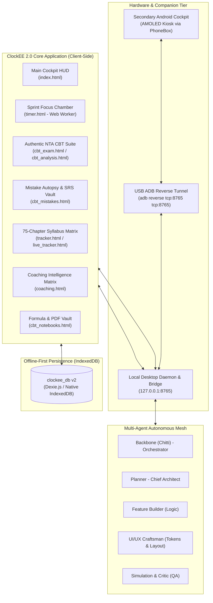

# ClockEE OS 2.0: Master Architectural Blueprint & First Draft Specification
**System Codename**: *The JEE Cockpit*  
**Author**: Planner (Chief Architect & Task Specification Engineer)  
**Target Orchestrator**: Backbone (Chitti) & The Multi-Agent Mesh Trio  
**Version**: 2.0.0-DRAFT  
**Date**: November 19, 2026  

---

## 1. Executive Vision & Philosophy: "Keep It Low"

### 1.1 The High-Stakes Context
A Joint Entrance Examination (JEE Main & Advanced) aspirant operates under intense cognitive pressure:
- **Time Constraint**: 180 minutes to solve 75 high-difficulty physics, chemistry, and mathematics problems ($\approx 2.4\text{ minutes/problem}$).
- **Precision Penalty**: $+4$ for correct, $-1$ for incorrect in Section A MCQs; Section B numerical responses require exact integer/decimal calculation with zero room for rounding errors.
- **Cognitive Budget**: Every visual distraction, neon glow, ungrounded animation, or layout jitter consumes working memory that belongs to complex integration, electrodynamics field equations, or reaction mechanisms.

### 1.2 The "Keep It Low" Design Standard
ClockEE V1 suffered from high-entropy "AI slop": excessive purple-cyan gradients, nested glassmorphic cards, fake gamified counters, and breaking runtime errors. 

**ClockEE 2.0 enforces a low-noise, low-friction, high-precision standard**:
1. **Low Visual Noise**: Zero decorative gradients. Zero glowing box shadows. Zero emoji badge spam. Deep obsidian slate backgrounds (`#090d16`) with high APCA contrast text (`#e2e8f0`, $Lc \ge 75$).
2. **Low Cognitive Load**: Every screen has one clear primary intent. Information is displayed in dense, scannable, monospaced tabular layouts (`tabular-nums`) with no shifting elements.
3. **Low Latency & High Durability**: 100% offline-first architecture powered by IndexedDB. Local UI transitions render in $<16\text{ ms}$ (60 FPS, CLS = 0.00). Web Worker-driven timers never drift when backgrounded.
4. **Authentic NTA Regulatory Parity**: The examination engine matches the National Testing Agency computer-based test (CBT) environment pixel-for-pixel and rule-for-rule.

---

## 2. Complete System Architecture & Module Map



---

## 3. Detailed Specifications of the 15 Core Modules

### Module 01: Main Cockpit HUD (`index.html`)
- **JEE Countdown Instrument**: Monospaced countdown ticker to JEE Main Session 1, Session 2, and JEE Advanced. Employs `font-feature-settings: "tnum"`; absolutely zero horizontal or vertical character jitter.
- **Daily Focus Ring**: Crisp SVG radial dial displaying completed study hours vs. daily goal (e.g., 6.5h / 8.0h).
- **Active Chamber State**: Physical instrument indicator reflecting timer state: `IDLE`, `DEEP_STUDY`, or `INTERMISSION`.
- **System Launchpad**: 1-click grid navigation to CBT Engine, Syllabus Tracker, Mistake Vault, and Coaching Matrix.
- **Physical Online/Offline LED**: Real-time beacon confirming browser storage sync status.

### Module 02: Sprint Focus Chamber (`timer.html`)
- **Web Worker Clock Engine**: Background timer thread running independent of the browser UI render loop, preventing time drift when the student switches tabs or minimizes the window.
- **Preset Protocols**: 25m Pomodoro, 50m Deep Block, and 90m Full Exam Simulation Block.
- **Context Tagging**: Mandatory single-select for Subject (Physics / Chemistry / Mathematics) and Chapter from the official 75-chapter syllabus.
- **Integrated Ambient Engine**: Web Audio API synthesis for calibrated pink noise, brown noise, and 40Hz gamma binaural pulses.
- **Zen Mode**: Instant hotkey (`Z`) hides all browser controls, presenting only the countdown digits and problem solve counter.

### Module 03: Daily Chronological Practice Digest (`today.html`)
- **Sanitized Practice Stream**: Solves the V1 `escapeHtml` crash by using native DOM element creation with zero raw string interpolation.
- **Practice Ledger**: Granular event log with timestamps:
  - `[09:15] Completed 50m Sprint: Physics - Rotational Dynamics (14 Qs solved, 85% accuracy)`
  - `[11:00] Attempted Chapter Test: Math - Definite Integrals (Score: 68/80)`
- **Revision Radar**: Daily list of topics reaching spaced repetition intervals (Day 1, Day 3, Day 7).
- **Rapid Increment Dock**: Keyboard shortcuts (`+` or numpad) to log single question completions during textbook problem drills without leaving the screen.

### Module 04: Kanban Task & DPP Hub (`task.html`)
- **4-Column Execution Board**: `Backlog` $\rightarrow$ `Today's Target` $\rightarrow$ `In Solving` $\rightarrow$ `Mastered`.
- **Card Metadata Standards**:
  - Subject Badge (Strict slate tint: Physics Sky `#38bdf8`, Chemistry Emerald `#34d399`, Mathematics Amber `#fbbf24`).
  - Estimated time vs. actual stopwatch time.
  - Question source tag (Coaching Sheet / PYQ 2024 / Irodov / MS Chouhan).
- **Keyboard Navigation**: Vim keys (`J`/`K` to move, `H`/`L` to shift columns, `Enter` to open task details).

### Module 05: Coaching Intelligence Matrix (`coaching.html`)
- **Test Score Ledger**: Records Test Series Name (Allen / FIITJEE / Resonance / Sri Chaitanya), Test Code, Date, Marks scored (out of 300), and All-India Rank / Percentile.
- **Dynamic Quartile Distribution**: SVG bell curve plotting the student's score against batch mean, median, 90th percentile, and 99th percentile.
- **Subject Balance Delta**: Visual triangle plot displaying PCM balance to immediately detect subject-weakness traps.
- **Upcoming Schedule Engine**: Syllabus tracking for coaching minors and majors with automated countdowns.

### Module 06 & 07: Authentic NTA CBT Examination Engine (`cbt_home.html`, `cbt_exam.html`)
- **Pixel-Perfect NTA 5-State Palette Machine**:
  1. `State 1: Not Visited` — Square, White background (`#ffffff`), Gray border (`#ced4da`), Dark text (`#212529`).
  2. `State 2: Not Answered` — Red trapezoid/polygon, Hex `#dc3545`, White text.
  3. `State 3: Answered` — Green trapezoid/polygon, Hex `#28a745`, White text.
  4. `State 4: Marked for Review` — Circle, Purple `#6f42c1`, White text.
  5. `State 5: Answered & Marked for Review` — Circle, Purple `#6f42c1` with Green dot/quadrant badge.
- **Section A (20 MCQs)**:
  - KaTeX mathematical typography for formulas, matrices, and reaction schemes.
  - 4 radio button options with instant state transition on selection.
- **Section B (10 Numericals, Attempt Any 5)**:
  - Virtual On-Screen Numeric Keypad (Digits 0–9, Negative Sign `-`, Decimal `.`, `Backspace`, `Clear`).
  - Active input filtering rejecting all alphabetical and special characters.
  - Strict submission rule: Maximum 5 questions allowed to be answered per subject section; attempts beyond 5 trigger a warning dialog.
- **Indestructible Exam State Persistence**:
  - Autosaves state to IndexedDB every 500 milliseconds.
  - If the browser crashes, computer restarts, or power drops, re-opening the exam restores the exact question index, elapsed timer, and palette state seamlessly.
- **Surgical Code Isolation**:
  - Rebuilt as an isolated ES6 class or IIFE module, eliminating V1's `Identifier 'sub' has already been declared` collision.

### Module 08: Post-Exam Diagnostic Autopsy (`cbt_analysis.html`)
- **Scorecard Calculation**:
  $$\text{Total Score} = (N_{\text{correct}} \times 4) - (N_{\text{incorrect}} \times 1)$$
- **Score Potential Calculator**:
  $$\text{Potential Score} = \text{Actual Score} + (N_{\text{incorrect}} \times 5) + \sum \text{Marks of Easy Unattempted}$$
- **8-Dimensional Diagnostics**:
  1. Unforced Calculation Error Rate.
  2. Conceptual Failure Rate.
  3. Time Allocation per Question (categorized into Fast $\le 90\text{s}$, Ideal $90-180\text{s}$, Trap $\ge 240\text{s}$).
  4. Section B Accuracy vs. Section A Accuracy.
  5. Question Selection Discipline (identifying whether hard questions were foolishly attempted before easy questions).

### Module 09: Mistake Hub & Spaced Repetition Chamber (`cbt_mistakes.html`)
- **Error Taxonomy**: Every failed question must be tagged before archiving:
  - `E1: Concept Failure` (Did not know formula or law).
  - `E2: Calculation Slip` (Arithmetic or algebra error).
  - `E3: Question Misread` (Failed to notice "NOT correct", units mismatch, standard temperature/pressure).
  - `E4: Time Panic` (Rushed in final 10 minutes).
- **Leitner 4-Tier Repetition Deck**:
  - Tier 1: 24-hour review.
  - Tier 2: 3-day review.
  - Tier 3: 7-day review.
  - Tier 4: 21-day mastery archive.
- **Blind Re-Solve**: Presents the problem without showing previous answers or hints, requiring full derivation before unlocking the verified solution.

### Module 10: Formula Notebooks & Scientific Vault (`cbt_notebooks.html`)
- **Sub-100ms Command Palette (`Ctrl+K` / `Cmd+K`)**: Instant fuzzy search across all standard JEE formulas (e.g., typing `Carnot` or `Schrodinger` immediately jumps to the equation).
- **Precision KaTeX Sheets**: Formulas categorized by Chapter and Sub-topic with verified dimensional units.
- **One-Click LaTeX Copying**: Copies the raw equation string for study notes or prompt generation.

### Module 11: Offline Reference Material & PDF Vault (`cbt_reference_vault.html`)
- **Service Worker Local Caching**: Uses CacheStorage API to store coaching modules, DPPs, and official NTA question papers for offline access.
- **Integrated PDF Canvas**: Custom PDF.js reader embedded in the cockpit with page memory and split-screen note-taking.

### Module 12: Multimodal AI Question Cloner Studio (`cbt_cloner.html`)
- **Numerical Re-Roll Engine**: Takes any past JEE problem and recalculates numerical constants while ensuring resulting solutions remain clean integers or standard fractions.
- **Concept Inverter**: Reverses dependent and independent variables to test bidirectional understanding.
- **Mathematical Sanity Validator**: Rejects any generated problem that fails closed-form physical or mathematical consistency checks.

### Module 13: 75-Chapter PCM Syllabus Intelligence Matrix (`tracker.html`)
- **Complete Class 11 & 12 Syllabus**: 28 Physics chapters, 30 Chemistry chapters (Physical, Inorganic, Organic), 17 Mathematics chapters.
- **3-Stage Mastery Matrix**:
  - Stage 1: Theory Lectures & Class Notes.
  - Stage 2: Coaching Module Exercises (Ex 1 & 2).
  - Stage 3: Past 10-Year PYQs (2015–2024).
- **High-Yield Exam Weightage Tags**: Highlights critical chapters with verified JEE Main question frequency (e.g., *Current Electricity*, *Thermodynamics*, *Matrices & Determinants*).

### Module 14: PhoneBox Android Kiosk Cockpit (`phonebox/`)
- **Hardware Integration**: Re-purposes any spare Android phone into a permanent hardware study console and agent monitor on the student's desk.
- **USB ADB Reverse Tethering**: Connects via `adb reverse tcp:8765 tcp:8765`, communicating with the local host over `127.0.0.1:8765` without Wi-Fi latency or firewall blocks.
- **AMOLED Kiosk Client**:
  - True pure black background (`#000000`) for zero glare and battery longevity.
  - Microscopic 2-pixel shifting every 120 seconds to prevent OLED burn-in.
  - Real-time display of active study timer, question solve rate, and agent mesh status.
- **Tactile Remote Approval**: Intercepts CLI prompts from the Antigravity multi-agent mesh, displaying physical `[ALLOW]` and `[DENY]` buttons on the phone screen for remote approval while away from keyboard.

### Module 15: Antigravity Session Bridge & Live Mesh Inspector (`live_tracker.html`)
- **Local WebSocket Bridge**: Connects to the desktop daemon (`server.py`) to stream real-time task statuses across all mesh agents (`Backbone`, `Planner`, `Feature Builder`, `UI/UX`, `Simulation`).
- **Live Activity Feed**: Terminal-grade log tracking file updates, test passes, and pipeline transitions without manual page refreshes.

---

## 4. Unified Offline-First Data Schema (`clockee_db` v2)

All client-side state is stored locally in IndexedDB using versioned object stores:

```javascript
const DB_CONFIG = {
  name: 'clockee_db',
  version: 2,
  stores: {
    // Study sessions and sprints
    sessions: 'id, timestamp, subject, chapter, durationMinutes, questionsCount, focusRating',
    
    // 75-Chapter Syllabus progress
    syllabus: 'chapterId, subject, classGrade, theoryStatus, exercisesStatus, pyqStatus, weightage',
    
    // NTA CBT Mock exams
    exams: 'examId, title, examType, dateAttempted, totalScore, physicsScore, chemScore, mathScore, timeSpentSeconds',
    
    // Question-level examination logs
    exam_responses: 'id, [examId+questionId], subject, section, state, selectedOption, numericalValue, timeSpentSeconds, isCorrect',
    
    // Mistake Hub & Spaced Repetition items
    mistakes: 'mistakeId, questionId, subject, chapter, errorCategory, intervalTier, nextReviewDate, resolvedCount',
    
    // Daily task board
    tasks: 'taskId, title, subject, priority, status, estimatedMinutes, createdAt, completedAt',
    
    // Coaching institute test logs
    coaching_tests: 'testId, institute, testCode, testDate, totalMarks, percentile, rank, pMarks, cMarks, mMarks',
    
    // System preferences & hardware config
    settings: 'key, value'
  }
};
```

---

## 5. Master Engineering Task Breakdown for Backbone (Chitti)

The following 15 tasks provide microscopic, airtight execution directives for Backbone to prioritize and dispatch to specialized agents:

| Task ID | Target Agent | Primary Objective | Deliverables |
|---|---|---|---|
| **`JEE-DES-015`** | UI/UX & Simulation | Anti-Slop Design Token System & Static Linter | `styles/tokens.css`, `scripts/lint-ui-slop.js` |
| **`JEE-CBT-001`** | Feature Builder | Crash-Resilient NTA CBT Exam Engine & 5-State Machine | `cbt_exam.html`, `scripts/cbt-engine.js` |
| **`JEE-UIX-002`** | UI/UX Craftsman | KaTeX Scientific Typography & Virtual Numeric Keypad | `scripts/virtual-keypad.js`, KaTeX styling rules |
| **`JEE-DAT-003`** | DB / Backend | Offline-First IndexedDB Schema & Migration Engine | `scripts/db.js`, `clockee_db` v2 initialization |
| **`JEE-HUD-004`** | Feature Builder | Main Cockpit HUD & Jitter-Free Countdown Ticker | `index.html`, `scripts/hud.js` |
| **`JEE-SYL-005`** | Feature Builder | 75-Chapter PCM Syllabus Intelligence Matrix | `tracker.html`, `scripts/syllabus-data.js` |
| **`JEE-ANA-006`** | UI/UX & Feature Builder | 8-Dimensional Diagnostic Autopsy & Potential Score | `cbt_analysis.html`, `scripts/analytics.js` |
| **`JEE-OCR-007`** | QA Engine & Backend | Coaching Scorecard Ingestion & Percentile Curve | `coaching.html`, score parser module |
| **`JEE-CLN-008`** | Feature Builder | AI Question Cloner Studio (Numerical Re-roll) | `cbt_cloner.html`, mathematical validator |
| **`JEE-TSK-009`** | Feature Builder | Kanban Task Hub with Keyboard Navigation | `task.html`, `scripts/kanban.js` |
| **`JEE-FIX-010`** | Bug Fix Specialist | Surgical Elimination of V1 Crash Bugs | Fixes for `const sub` and `escapeHtml` |
| **`JEE-BOX-011`** | DB / Backend | Desktop Companion Daemon & USB ADB Bridge | `server.py`, `scripts/adb-reverse.bat` |
| **`JEE-APP-012`** | UI/UX Craftsman | AMOLED Kiosk Client & Pixel-Shift Guardrail | `phonebox/index.html`, `phonebox/kiosk.css` |
| **`AGY-RELAY-013`**| DB / Backend | Antigravity Conversation Bridge & Remote Approval | `scripts/agent-relay.py`, WebSocket endpoint |
| **`JEE-SIM-014`** | Simulation & Critic | End-to-End Headless Examination & Boundary Test | `tests/cbt-simulation.spec.js` |

---

## 6. Strict Acceptance & Quality Guardrails

To prevent any regression into AI slop or exam-day failures, every build must satisfy:
1. **Zero Console Errors**: Not a single `Uncaught TypeError`, `SyntaxError`, or unhandled promise rejection under any user interaction.
2. **Deterministic Offline Operation**: The application functions at 100% capability with the network disconnected. All assets (fonts, KaTeX bundles, icons) are served locally.
3. **APCA Contrast Compliance**: Text-to-surface contrast $\ge Lc\ 75$ across all views; zero low-contrast gray text on dark gray surfaces.
4. **Layout Stability**: Cumulative Layout Shift (CLS) strictly equal to `0.00`. No shifting headers or resizing buttons when timers tick or math formulas load.
5. **Exact NTA Scoring**: Section A ($+4/-1$), Section B ($+4/0$, max 5 attempts), total marks capped at 300.

---

### Handoff Directive
**This blueprint represents the canonical architectural draft for ClockEE OS 2.0. Ready for Backbone (Chitti) to prioritize, schedule, and dispatch across the builder trio.**
