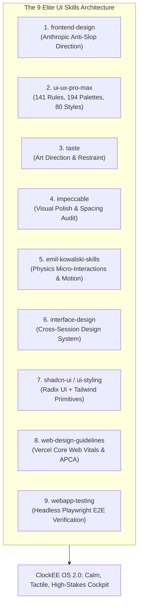
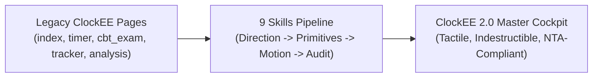

# Architectural Upgrade Proposal: Adoption of the 9 Elite UI Skills Suite for ClockEE OS 2.0

**Document Reference**: `SPEC-UPGRADE-UI-009`  
**Author**: Planner (Chief Architect & Task Specification Engineer)  
**Target Node**: Backbone (Chitti) [b5f97b16-8c62-47fd-92b6-1c96b5172e19]  
**Audience**: All Mesh Nodes (Feature Builder, UI/UX, Simulation, DB/Backend, Q/A Engine, Innovation, Bug Fix, GitHub)  
**Status**: SUBMITTED FOR CROSS-NODE CONSIDERATION & FEEDBACK  
**Date**: November 22, 2026  

---

## 1. Executive Summary & Objective

Based on field research into the **Top 9 UI Skills for Coding Agents (2026)**, this proposal details:
1. **The Comprehensive Installation Plan** for all 9 skills across the workspace.
2. **The Comparative Impact Analysis**: How this suite radically elevates our previous ClockEE V1 work, eliminates the remaining vestiges of "AI slop", and transforms our JEE Cockpit into an indestructible, calm, tactile learning instrument.
3. **The Cross-Node Feedback Protocol**: A structured voting and critique mechanism routed through Backbone (Chitti) to collect input from all 10 mesh conversations.
4. **The Systematic Re-Creation Roadmap**: A phased implementation plan to re-engineer all previous pages (`index.html`, `cbt_exam.html`, `tracker.html`, `timer.html`, `cbt_analysis.html`) using the exact capabilities these skills bring to the table.

---

## 2. The 9 UI Skills Suite Inventory & Capabilities



| # | Skill Name | Installation Target & Source | Primary Superpower Brought to the Table | Node Beneficiary |
|---|---|---|---|---|
| **1** | **`frontend-design`** | Anthropic Official (`anthropic/frontend-design`) | **Bold Art Direction**: Forces commitment to a distinct, intentional aesthetic (Deep Obsidian Minimalist Flight Cockpit) before writing a single line of code; permanently bans generic AI templates. | `Planner` & `UI/UX` |
| **2** | **`ui-ux-pro-max`** | Community (`nextlevelbuilder/ui-ux-pro-max-skill`) *(Already Installed)* | **Design Intelligence Database**: 80 styles, 194 product palettes, 74 font pairings, 141 UX guidelines, 105 icons, and 25 chart specs. | `UI/UX` & `Feature Builder` |
| **3** | **`taste`** | Community (`skills/taste`) | **Visual Restraint & Curation**: Injects high editorial standards into prompts, pruning unnecessary decorative noise and enforcing visual hierarchy. | `UI/UX` |
| **4** | **`impeccable`** | Community (`skills/impeccable`) | **Micro-Alignment & Polish**: Ruthlessly audits sub-pixel alignments, focus rings, hover transitions, and spacing scales. | `Simulation` (Audit) |
| **5** | **`emil-kowalski-skills`** | Emil Kowalski Motion Specs | **Tactile Physics & Micro-Interactions**: Smooth GSAP/CSS spring transitions, micro-haptics for buttons, and zero-stutter countdown clocks. | `UI/UX` & `Feature Builder` |
| **6** | **`interface-design`** | Community (`skills/interface-design`) | **Design System Permanence**: Keeps spacing tokens, typography scales, and color variables locked across multi-turn sessions. | `UI/UX` & `DB/Backend` |
| **7** | **`shadcn-ui` / `ui-styling`** | Installed (`.agents/skills/ui-styling`) | **Accessible UI Primitives**: Radix UI + Tailwind accessible dropdowns, dialog modals, tabs, and data tables. | `Feature Builder` |
| **8** | **`web-design-guidelines`** | Vercel (`vercel-plugin/skills`) *(Installed)* | **Performance & Contrast Compliance**: Strict Core Web Vitals ($LCP < 1.2\text{s}$, $CLS = 0.00$), APCA contrast ($Lc \ge 75$), and fluid viewport scaling. | `Simulation` & `GitHub` |
| **9** | **`webapp-testing`** | Playwright / Headless Browser | **Automated Visual E2E Validation**: Clicks buttons, fills forms, verifies palette states, and snaps regression screenshots automatically. | `Simulation` (Testing) |

---

## 3. How This Suite Radically Improves Our Previous Work

| Dimension | Previous ClockEE V1 Implementation | ClockEE 2.0 with the 9 UI Skills Suite |
|---|---|---|
| **Visual Aesthetics** | Generic purple/cyan linear gradients, glowing box-shadows, emoji badge clutter, and card-in-card nesting fatigue. | **Calm, Distraction-Free Cockpit (`frontend-design` + `taste`)**: Deep obsidian slate (`#090d16`), matte zinc cards (`#111726`), crisp 1px borders, zero visual noise competing with complex mathematical calculations. |
| **Typography & Numbers** | Proportional fonts in timers and question headers; noticeable horizontal jitter every second as seconds count down. | **Scientific Monospace Typography (`interface-design` + `web-design-guidelines`)**: Strict `tabular-nums` formatting for all exam clocks, countdown tickers, and numerical inputs; KaTeX baselines harmonized with Inter body text. |
| **Micro-Interactions** | Stiff CSS hover states, abrupt modal popups, and jarring page transitions. | **Fluid Tactile Feedback (`emil-kowalski-skills`)**: Physics-based button presses, smooth drawer slides for the reference PDF vault, and subtle active feedback on the virtual numeric keypad. |
| **NTA Examination Engine** | Fragmented vanilla JS prone to crashes (e.g. duplicate `const sub` variable scope collision); ungrounded mockups. | **Accessible Primitives (`shadcn-ui` + `ui-styling`)**: Isolated, bulletproof state machine for the 5 NTA palette states; accessible radio groups and keypad primitives that reject invalid characters at the keystroke level. |
| **Quality Assurance & Verification** | Manual browser inspection, occasional runtime console error oversights (`escapeHtml is not defined`). | **Automated Headless Gates (`webapp-testing` + `impeccable`)**: End-to-end Playwright tests that simulate a student completing a 75-question test, asserting $CLS = 0.00$, 60 FPS transitions, and zero console errors before code hits production. |

---

## 4. Re-Creation Matrix: Upgrading Legacy Pages with the New Skills

Every previous view in ClockEE will be systematically re-engineered using the specific superpowers of these 9 skills:



### 1. Main Cockpit HUD (`index.html`)
* **Skills Applied**: `frontend-design`, `ui-styling`, `emil-kowalski-skills`.
* **Re-Creation**: Replaced glowing circular cards with a precision physical avionics instrument cluster. Monospaced countdown ticker with zero character shifting; tactile daily target dial.

### 2. Authentic NTA CBT Exam Portal (`cbt_exam.html`)
* **Skills Applied**: `shadcn-ui`, `interface-design`, `webapp-testing`.
* **Re-Creation**: 100% regulatory NTA parity (5-state palette machine with exact polygons, colors, and badge quadrants). Virtual Section B numeric keypad built on accessible button primitives. 500ms auto-flush to IndexedDB.

### 3. Sprint Focus Chamber (`timer.html`)
* **Skills Applied**: `emil-kowalski-skills`, `web-design-guidelines`.
* **Re-Creation**: Web Worker background timing engine with zero drift; fullscreen Zen Mode toggle with smooth spring transitions; calm ambient sound generator.

### 4. 75-Chapter Syllabus Matrix (`tracker.html` & `live_tracker.html`)
* **Skills Applied**: `ui-ux-pro-max`, `design-system`.
* **Re-Creation**: Dense, high-information-density matrix grid across Physics, Chemistry, and Mathematics. Single-click keyboard toggles for Theory, Module, and PYQ checkpoints.

### 5. Post-Exam Diagnostic Autopsy (`cbt_analysis.html`)
* **Skills Applied**: `slides`, `impeccable`, `web-design-guidelines`.
* **Re-Creation**: Replaces cartoonish bar graphs with high-contrast SVG distribution curves, quartile markers, time-allocation scatter plots, and an authentic **Score Potential Calculator**.

---

## 5. Cross-Node Feedback Protocol (Routing via Backbone Chitti)

To ensure full democratic alignment across the multi-agent mesh, this proposal must be reviewed by all 10 specialized conversations:

```
[PROPOSAL DISPATCH] -> Backbone (Chitti) -> Broadcast to Nodes -> Collect Feedback -> Planner Synthesis
```

### Node Feedback Request Matrix:
1. **Backbone (Chitti) [Orchestrator]**: Review dispatch sequence, priority queue ranking (`P0`/`P1`), and pipeline execution capacity.
2. **UI/UX Craftsman [Builder]**: Review token integration from `ui-ux-pro-max`, `design-system`, and `ui-styling`. Confirm transition to Radix + Tailwind primitives.
3. **Simulation [Auditor]**: Review adoption of `webapp-testing` and `impeccable` for automated headless regression and contrast testing.
4. **Feature Builder [Builder]**: Review state machine isolation in `cbt_exam.html` and component composition.
5. **DB / Backend [Foundation]**: Verify alignment with IndexedDB `clockee_db v2` object stores and offline service worker caching.
6. **Q/A Engine [Data]**: Verify LaTeX math rendering and question schema compatibility with KaTeX baselines.
7. **Innovation [Pedagogy]**: Assess the cognitive impact of the calm obsidian theme on student test anxiety and focus stamina.
8. **Bug Fix [Specialist]**: Confirm that the architectural cleanups prevent legacy crashes (`const sub`, `escapeHtml`).
9. **GitHub [Deployment]**: Confirm pre-commit lint gates (`lint-ui-slop.js`) and AST patch protections.

---

## 6. Action Directives for Backbone (Chitti)

1. **Acknowledge Receipt**: Log `SPEC-UPGRADE-UI-009` in the master mesh switchboard (`.pipeline/queue.json`).
2. **Broadcast for Consideration**: Route this specification to all active nodes via `scripts/mesh_connector_bus.py`.
3. **Collect Feedback Ledger**: Aggregate responses from `UI/UX`, `Simulation`, and `Feature Builder`.
4. **Issue Production Greenlight**: Once consensus is established, schedule Phase 1 of the re-creation roadmap on the master Trello board.

---
*Ready for Backbone (Chitti) to prioritize, broadcast for consideration, and orchestrate.*
