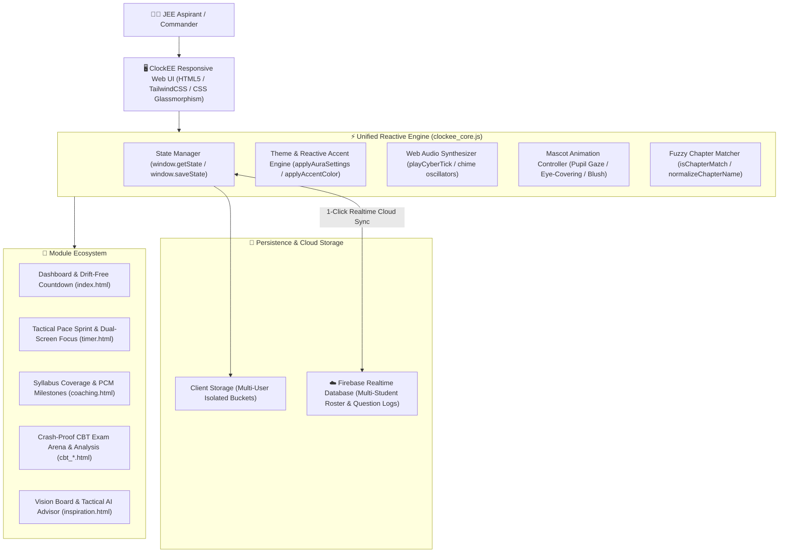

# ⚡ ClockEE — Autonomous JEE Advanced Tactical Cockpit & Cognitive CBT Engine

[](https://github.com)
[](https://github.com)
[](https://github.com)
[](https://firebase.google.com)
[](LICENSE)

> **ClockEE** is a high-performance, distraction-free study operating system and tactical examination cockpit engineered specifically for **JEE Advanced & Mains** aspirants. It replaces fragmented coaching spreadsheets and generic Pomodoro timers with sub-second pace latency metrics, crash-proof CBT exam simulation, error autopsy sequence vaults, and multi-student cloud isolation.

---

## 🌐 Live Hackathon Showcase & Deployment Links

| Resource | Direct Link | Description |
| :--- | :--- | :--- |
| 🏆 **Official Hackathon Portal** | **[Launch Hackathon Showcase](https://galacticzenpai.github.io/ClockEE/hackathon.html)** | Interactive project pitch, judge credentials, registration JSON & system tour |
| 🌐 **GitHub Pages Live App** | **[Launch via GitHub Pages](https://galacticzenpai.github.io/ClockEE/)** | High-speed global CDN deployment of ClockEE on GitHub Pages |
| 🐻 **Interactive Mascot Portal** | **[Launch Login & Mascot Sandbox](https://galacticzenpai.github.io/ClockEE/login.html)** | Cyber-Bear interactive mascot with gaze tracking, blush, and password eye-covering |
| 🎯 **Tactical Pace Benchmark Sprint** | **[Launch Question Sprint Arena](https://galacticzenpai.github.io/ClockEE/timer.html)** | Sub-second lap cadence, JEE +4/-1 scoring, and error autopsy uploader |
| 📚 **Coaching Syllabus Matrix** | **[Launch Coaching Matrix](https://galacticzenpai.github.io/ClockEE/coaching.html)** | PCM Milestone blocks, fuzzy chapter match, and cyber checkboxes |
| ☁️ **Cloud Student Admin Roster** | Real-time multi-aspirant roster management, database ping & diagnostics |

---

## 🚀 Project Development Roadmap & Progress (50% Milestone)

```text
[████████████████████████████████████████] 50% COMPLETED
```

### ✅ Phase 1: Core Architecture Delivered (50% Completed)
- **Drift-Free Sub-Second Tactical Clock**: Millisecond temporal delta engine eliminating background tab throttling.
- **Whimsical Biometric Mascot**: Procedural cursor gaze tracking, cheek blush upon nose click, and robotic eye-shielding paws.
- **Authentic NTA CBT Simulator**: Zero-loss crash recovery on refresh, full LaTeX MathJax formulas, and official question palette.
- **Multi-User Cloud Sync & Isolation**: Profile switching (Alpha, Beta, Guest) backed by Firebase Realtime DB and local storage isolation.
- **PCM Milestone Coverage Matrix**: 3-block tracking (Previous Mastered, In-Progress, Next Queued) with cyber chimes.
- **8 Dynamic Nebula Themes & Accent Engine**: Real-time reactive CSS variable recalculation without page reload.

### 🚧 Phase 2: Cognitive Pipeline In Development (50% Remaining)
- **1. Task Flow System**: Algorithmic task queue converting CBT test error autopsies and coaching syllabus gaps into prioritized daily tasks, complete with drag-and-drop Kanban matrix, sub-tasks, and automated rollover.
- **2. Adaptive AI Question Generation**: Fine-tuned algorithmic generator synthesizing tailored JEE Mains and Advanced numerical problems, multi-correct challenges, and step-by-step LaTeX formula derivations adapting to aspirant difficulty.
- **3. Retheming & Visual Studio**: Comprehensive user customization studio for backdrop blur intensity, glassmorphic refraction, custom color wheel gradients, and Web Audio synthesizer mechanical clicker sound packs.

---

## 🏆 Hackathon Project Abstract & Problem Statement

### The Problem
Preparing for India's **JEE Advanced** (Joint Entrance Examination) is one of the most grueling academic competitions in the world, with over **1.5 million students** competing for fewer than 10,000 top IIT seats. Aspirants face three critical hurdles:
1. **The Pace Blindspot**: Students often practice numericals without tracking **per-question cadence**. Spending 6 minutes on a 2-minute question in practice leads to fatal time crises during the actual exam.
2. **Post-Crash Exam Anxiety**: Traditional web test portals lose selected answers and elapsed time if the browser crashes or refreshes mid-test.
3. **Fragmented Workspaces & Isolation**: Aspirants alternate between PDF modules, YouTube lecture marathons, and coaching sheets across multiple devices without unified state persistence or account isolation.

### The Innovation
ClockEE solves this by providing a unified **Tactical Cockpit**:
- **Real-Time Pace Benchmark Engine**: Computes instant latency benchmarks (e.g., `20.0s/Q` for Rapid Drill, `120s/Q` for Advanced Numericals). Active Question cards compute real-time lap deltas (`-4.2s Faster` / `+12.1s Slower`), updating projected JEE scores live!
- **Error Autopsy & Incorrect Sequence Vault**: Wrong attempts trigger immediate categorization (Calculation, Concept Gap, Silly Error) and accept sequential text/screenshot problem autopsy attachments.
- **Crash-Proof CBT Exam Engine**: Full PYQ test simulator with authentic MathJax/LaTeX rendering, auto-saving responses to `localStorage` and Firebase with zero-loss crash recovery on refresh.
- **Whimsical Cyber-Bear Mascot**: Transforms stressful authentication into an engaging experience with horizontal eye tracking, cheek blushing upon nose click, Web Audio sound effects, and paws sliding up to cover its eyes when focusing on the password field!
- **100% Client-Side Reactive Core with Firebase**: 8 dynamic ambient nebula themes, real-time CSS `:root` variable recalculation, and multi-user profile switching with 1-click cloud synchronization.

---

## 📸 System Tour & Feature Deep Dive

### 1. Tactical Question Solving Sprint Arena (`timer.html`)
- **HUD 4-Card Dashboard**:
  - `TOTAL ELAPSED`: Running block time with live remaining countdown.
  - `ACTIVE QUESTION`: Sub-second lap stopwatch, active question badge (`Q #1`), and pace health comparison.
  - `PACE HEALTH`: Real-time indicator dot (Ahead of Pace / Behind Pace).
  - `PROJECTED JEE SCORE`: Dynamic score projection based on JEE Mains (`+4 / -1`) or Advanced (`+4 / -2`) marking scheme.
- **Incorrect Question Sequence Uploader**:
  - Filter mistakes in chronological sequence (`✕ Q#2`, `✕ Q#4`).
  - Attach problem statements via markdown text or drag-and-drop screenshot uploads.
- **Custom Glassmorphic Dropdowns**:
  - Replaces native OS selects with transparent frosted glass menus (`backdrop-filter: blur(32px)`), glowing cyber cyan borders, and smooth keyboard/mouse navigation.

### 2. Dual-Screen Lecture Focus Arena (`timer.html`)
- 3-tier digital clock box with rapid presets (`25m Pomodoro`, `50m Deep Work`, `90m Mains`, `180m Advanced`).
- Side-by-side split layout for real-time lecture notes with `📌 Insert Current Timestamp` button.
- Secondary Floating Mini-Timer HUD (`mini_timer.html`) for multi-monitor setups.
- Distraction-Free Lo-Fi Ambient Radio stream integration.

### 3. Coaching Syllabus Coverage Matrix (`coaching.html`)
- **3 PCM Milestone Blocks**:
  - `✓ PREVIOUS CHAPTERS (PCM)`: Mastered chapter review with questions completed.
  - `🔄 IN PROGRESS (PCM)`: Active chapters with neon progress bars and deliberate study hours.
  - `📅 NEXT CHAPTERS (PCM)`: Queued chapters with 1-click `▶ Start` focus trigger.
- **Robust Fuzzy Chapter Aggregator**:
  - Automatically matches variations like `"Basic Math & Vectors"` and `"Basic Mathematics & Vectors"` across logs, ensuring zero missing question counts.
- **Themed Cyber Checkboxes**:
  - Synthesized dual-tone audio chimes (`playCyberTick`) via HTML5 Web Audio API on state toggle.

### 4. Authentic JEE CBT Exam Engine (`cbt_home.html`, `cbt_exam.html`, `cbt_analysis.html`)
- Authentic NTA/IIT JEE user interface styling.
- Real LaTeX formulas rendered via MathJax.
- Persistent question palette (Answered, Marked for Review, Unvisited).
- Instant Crash Recovery: Page reload resumes exact timer state and marked answers.
- Comprehensive Analysis: Accuracy doughnut, subject latency breakdown, and error taxonomy.

### 5. Whimsical Cyber-Bear Authentication Portal (`login.html`)
- Interactive SVG mascot with responsive eyes that track the cursor horizontally during email input.
- Squishy nose boop triggers cheek blushing and encouraging JEE motivational quotes via speech bubble.
- Secret Easter Egg badges (⚛️ Physics, 🧪 Chemistry, 🚀 Rocket) trigger science Easter eggs.
- Password Security Meter with real-time requirements checklist and pupil star glints upon reaching 100%.
- Interactive paws that smoothly cover the mascot's eyes when focusing on the password field, with a one-eye peek when toggling password visibility!

### 6. Master Themes & Reactive Accent Engine (`settings.html`, `clockee_core.js`)
- **8 Calibrated Nebula Background Themes**:
  1. `Cyber Cyan & Indigo` (Default)
  2. `Deep Space Violet & Neon Magenta`
  3. `Emerald Matrix & Electric Teal`
  4. `Crimson Nova & Sunset Amber`
  5. `Midnight Arctic Aurora & Ice Blue`
  6. `Quantum Gold & Amber Circuit`
  7. `80s Synthwave Sunset & Electric Rose`
  8. `Stealth Obsidian & Steel Blue`
- **Reactive Master Accent Color**:
  - 8 instant 1-click swatches (Cyan, Indigo, Violet, Emerald, Amber, Crimson, Ice Blue, Lime).
  - Dynamically recalculates CSS `:root` variables (`--accent`, `--accent-soft`, `--accent-glow`) in real time across all open pages without page reloads!

---

## 🏗️ System Architecture & Data Flow



---

## 📁 Repository Directory Structure

```text
ClockEE/
├── hackathon.html               # Official Hackathon Showcase, Judging Toolkit & Registration Portal
├── index.html                   # Master Dashboard, Mission Vitals & Heatmap
├── timer.html                   # Tactical Pace Sprint, Lecture Focus Block & Error Autopsy
├── mini_timer.html              # Dual-Screen Popout Mini-Timer for 2nd monitors
├── coaching.html                # Coaching Syllabus Matrix, PCM Milestones & Question Logs
├── cbt_home.html                # CBT Examination Hub & Adaptive Test Launcher
├── cbt_instructions.html        # Authentic Examination Instructions Screen
├── cbt_exam.html                # Crash-Proof CBT Exam Arena with LaTeX rendering
├── cbt_analysis.html            # Post-Exam Diagnostics, Latency Breakdown & Charts
├── cbt_reference_vault.html     # Reference Book Vault & Offline Material Tracker
├── inspiration.html             # JEE Vision Board, Tactical AI Advisor & News Desk
├── task.html                    # Task Command Terminal & Kanban Matrix
├── today.html                   # Daily Vitals & html2canvas Report Card Generator
├── settings.html                # Master Settings, 8 Nebula Themes & Reactive Accent Swatches
├── login.html                   # Whimsical Cyber-Bear Mascot, Google Sign-In & Auth
├── clockee_core.js              # Universal Reactive Core, Web Audio & Cloud Sync Engine
├── README.md                    # Project Documentation & Hackathon Pitch
└── LICENSE                      # MIT License
```

---

## 🚀 Quick Start / Local Installation

ClockEE is built with zero cumbersome build steps, compilers, or heavy node_modules. It runs instantly in any modern web browser!

### Option 1: Clone and Run via Python Server
```bash
# Clone the repository
git clone https://github.com/galacticzenpai/ClockEE.git
cd ClockEE

# Start a local HTTP server
python -m http.server 8080
```
Open **`http://localhost:8080`** or **`http://localhost:8080/hackathon.html`** in your browser.

### Option 2: Direct Browser Launch
Simply double-click `hackathon.html`, `index.html`, or `login.html` to run in standalone client mode.

---

## ⚖️ Hackathon Evaluation & Judge Test Credentials

For hackathon judges and evaluators, pre-seeded test accounts and administrative PINs are provided:

| Account / Role | Email / Identifier | Passcode / PIN | Description |
| :--- | :--- | :--- | :--- |
| 🧑‍🎓 **Student Alpha (Active)** | `alpha@clockee.app` | `password123` | Active aspirant account pre-seeded with solved questions, streaks, and syllabus progress |
| 🧑‍💻 **Student Beta (Isolated)** | `beta@clockee.app` | `password456` | Secondary aspirant account demonstrating 100% strict multi-user client & cloud isolation |
| 🛡️ **Admin & Mentor Panel** | Multi-user roster manager, live Firebase connection health, and custom question injector |
| 🚀 **Guest Sandbox** | 1-Click Launch | *None* | Direct instant bypass into the complete suite with zero signup friction |

---

## 🏅 Hackathon Project & Registration Metadata

- **Project Name**: ClockEE (JEE 2028 Study Engine)
- **Author / Lead Developer**: Kunal Sahoo ([@galacticzenpai](https://github.com/galacticzenpai))
- **Category / Tracks**: EdTech, AI & Productivity, Best Dual-Screen UX, Cognitive Engineering
- **GitHub Repository**: [https://github.com/galacticzenpai/ClockEE](https://github.com/galacticzenpai/ClockEE)
- **Live GitHub Pages URL**: [https://galacticzenpai.github.io/ClockEE/](https://galacticzenpai.github.io/ClockEE/)
- **Live Hackathon Portal**: [https://galacticzenpai.github.io/ClockEE/hackathon.html](https://galacticzenpai.github.io/ClockEE/hackathon.html)
- **Database Engine**: Firebase Realtime Database with Resilient Offline-First LocalStorage
- **License**: [MIT License](LICENSE)

---

<p align="center">
  <b>Built with passion and mathematical precision for future IITians. 🚀</b><br>
  <i>"Target Top 50 AIR — Every Second Counts."</i>
</p>
