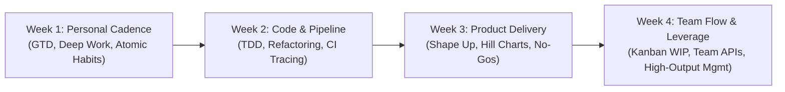

# The Master Playbook: How the World's Top 100 Task Planners & Engineering Leaders Think, Work, and Ship

**Target Audience**: The Beginner Engineer, Tech Lead, and Planner  
**Pedagogical Premise**: "Stand on the shoulders of giants. Internalize their mental models, speak their language, adopt their daily habits, and execute their practice drills."  
**Compiled by**: Antigravity Swarm Intelligence & Browser Field Research  
**Date**: November 21, 2026  

---

## Table of Contents
1. [Pillar I: Executive Engineering Leadership & Organizational Leverage](#pillar-i-executive-engineering-leadership--organizational-leverage)
   - *Andy Grove, Will Larson, Camille Fournier, Charity Majors, Gergely Orosz, Martin Fowler, Kent Beck, Michael Lopp, Claire Hughes Johnson, Addy Osmani*
2. [Pillar II: Flow Engineering, DevOps, DORA & Task Slicing](#pillar-ii-flow-engineering-devops-dora--task-slicing)
   - *Gene Kim, Jez Humble, Dr. Nicole Forsgren, Dave Farley, David J. Anderson, Henrik Kniberg, Dominica DeGrandis, Matthew Skelton & Manuel Pais*
3. [Pillar III: The Shape Up Revolution & Product Delivery](#pillar-iii-the-shape-up-revolution--product-delivery)
   - *Ryan Singer & Jason Fried (37signals)*
4. [Pillar IV: Personal Flow, Deep Work & High-Output Task Systems](#pillar-iv-personal-flow-deep-work--high-output-task-systems)
   - *David Allen, Tiago Forte, Cal Newport, James Clear, Oliver Burkeman, Swyx, Alex Xu, Paul Graham*
5. [Pillar V: The Beginner's Active Testing & Learning Protocol](#pillar-v-the-beginners-active-testing--learning-protocol)
   - *Step-by-step 30-day curriculum to test and apply these models one by one*

---

## Pillar I: Executive Engineering Leadership & Organizational Leverage

### 1. Andy Grove (Former CEO & Chairman, Intel)
* **Archetype**: The High-Leverage Operational Maestro & Industrial Systems Thinker
* **How He Thinks**:
  * *Managerial Output Formula*: $\text{Manager's Output} = \text{Output of Organization} + \text{Output of Neighboring Organizations Influenced}$. Management is not individual contribution; it is an operational multiplier.
  * *Managerial Leverage (HLA)*: Rank every activity by its leverage ratio (output generated per unit of time invested). High-leverage actions affect many people over a long period or inject timely, critical knowledge into a bottleneck.
  * *Task-Relevant Maturity (TRM)*: Management style (Directive vs. Supportive vs. Delegative) must match the subordinate's competence on the *specific task*, not their overall career seniority.
  * *The Limiting Step*: Every workflow has one step that dictates the overall cycle time. Locate it, build your schedule around it, and inspect quality at the lowest-value stage (upstream).
* **Core Words & Mantras**:
  * *"Only the paranoid survive."*
  * *"Let chaos reign, then rein in chaos."*
  * *"Bad companies are destroyed by crisis. Good companies survive them. Great companies are improved by them."*
  * *"A manager's output is the output of the organizational units under his or her supervision."*
* **Key Books & Canons**:
  * *High Output Management* (1983/1995, Vintage Books) — The foundational bible of operational leverage and OKRs.
  * *Only the Paranoid Survive* (1996) — Navigating 10x Strategic Inflection Points.
* **Tactical Tips & Tricks**:
  * **The 90-Minute 1-on-1**: Grove prescribed 60–90 minute 1:1s driven strictly by the subordinate's agenda ("The subordinate's meeting"). The manager listens 80% of the time, asks probing questions, and uncovers unspoken roadblocks.
  * **Lowest-Cost Inspection**: Catch defects at the raw material or outline stage. Reviewing an architecture RFC outline costs \$50 of developer time; fixing a broken architectural schema in production costs \$50,000.
  * **Leading Indicators**: Track 3–5 daily leading operational indicators (pipeline inventory, unreviewed PRs, CI queue latency) rather than waiting for lagging metrics (missed sprint dates).
* **Beginner Practice Drill ("Act Like Them")**:
  * **The Managerial Leverage Audit**: Review your last two weeks of calendar entries. Tag each 30-minute block as: (A) Low Leverage (status updates, manual data entry), (B) Medium Leverage (routine PR reviews), or (C) High Leverage (building reusable templates, fixing a shared CI bottleneck, TRM coaching). Cancel or delegate two Low-Leverage slots tomorrow and substitute a 60-minute High-Leverage operational intervention.

---

### 2. Will Larson (CTO, Author; Carta, Stripe, Uber)
* **Archetype**: The Organizational Systems Architect & Staff-Plus Cartographer
* **How He Thinks**:
  * *Systems Thinking in Engineering Orgs*: Treat engineering organizations as complex dynamical feedback loops with stocks, flows, and delays. Never solve recurring problems with personal heroics; re-engineer the system constraints.
  * *The Four States of Engineering Teams*: (1) Falling Behind (backlog grows), (2) Treading Water (working flat out just to stay even), (3) Repaying Debt (recovering capacity by clearing tech debt), (4) Innovating (low friction, sustained feature delivery). A team cannot jump from Falling Behind directly to Innovating—it must transition sequentially through Repaying Debt.
  * *Team Sizing Heuristics*: Teams smaller than 4 are fragile; teams larger than 8 suffer coordination collapse. Standardize on 6–8 engineers per team.
  * *Staff-Plus Archetypes*: The Tech Lead, the Architect, the Solver, and the Right Hand.
* **Core Words & Mantras**:
  * *"Fix the system, not the incident."*
  * *"Organizations are systems; treat them that way."*
  * *"Velocity is the byproduct of continuous technical debt repayment."*
* **Key Books & Canons**:
  * *An Elegant Puzzle: Systems of Engineering Management* (Stripe Press, 2019)
  * *Staff Engineer: Leadership Beyond the Management Track* (2021)
  * Publication: *Irrational Exuberance* (`lethain.com`)
* **Tactical Tips & Tricks**:
  * **The Innovation Token Model**: When architecting a new system, allocate only 1–2 "innovation tokens" (novel databases or exotic frameworks); build everything else on boring, battle-tested technology.
  * **Work on What Matters**: For every proposed technical initiative, explicitly articulate the business metric it moves (Retention, Latency, CAC, or Risk).
* **Beginner Practice Drill ("Act Like Them")**:
  * **The Team State Diagnostic**: Diagnose your current team or personal project across the 4 states. If "Falling Behind", declare a temporary feature freeze, tackle the single biggest developer friction point (e.g., slow test suite), and measure the recovered weekly hours.

---

### 3. Camille Fournier (Two Sigma, Rent the Runway)
* **Archetype**: The Engineering Career Ladder & Human Transition Guide
* **How She Thinks**:
  * *The Dual-Track Progression*: Engineering leadership is a distinct discipline requiring new skills (empathy, delegation, business translation) rather than an automatic reward for high code output.
  * *The Delegation Paradox*: The hardest transition is letting go of writing code. You must learn to delegate problems, not just tasks, and accept solutions that differ from how you would have implemented them.
* **Core Words & Mantras**:
  * *"Your job as a manager is not to do the work, but to make sure the work gets done."*
  * *"Don't micromanage the implementation; clarify the definition of done."*
  * *"Feedback is a gift that rots if not delivered within 48 hours."*
* **Key Books & Canons**:
  * *The Manager's Path: A Guide for Tech Leaders Navigating Growth and Change* (O'Reilly, 2017)
* **Tactical Tips & Tricks**:
  * **Task Delegation Ladder**: (1) "Tell them what to do", (2) "Ask them to research options and recommend", (3) "Ask them to decide and inform you", (4) "Full autonomy".
  * **The 48-Hour Feedback Rule**: Deliver critical feedback within 48 hours of observing the behavior; never hoard constructive critique for annual performance cycles.
* **Beginner Practice Drill ("Act Like Them")**:
  * **The "Problem over Task" Delegation**: Take an upcoming task. Write a 1-paragraph brief defining strictly the *Problem Statement* and the *Acceptance Criteria* (Definition of Done), with zero implementation steps. Hand it off to a peer or subagent and evaluate strictly against the acceptance criteria.

---

### 4. Charity Majors (CTO, Honeycomb.io)
* **Archetype**: The Production-First Observability & Sociotechnical Provocateur
* **How She Thinks**:
  * *Production is the Only Source of Truth*: Testing in staging is necessary but insufficient. True system behavior only reveals itself under live, distributed production traffic.
  * *The Sociotechnical Feedback Loop*: On-call rotations should be owned by the engineers who author the code. If an engineer feels the operational pain of bad code, code quality immediately self-corrects.
  * *Observability vs. Monitoring*: Monitoring alerts you when known thresholds breach; observability allows you to ask arbitrary questions about unknown-unknown system states without deploying new code.
* **Core Words & Mantras**:
  * *"Nines don't matter if your users are unhappy."*
  * *"If you don't test in production, you are testing on your users."*
  * *"Code is not done until it has been running safely in production under real traffic."*
  * *"Software engineering is a sociotechnical system."*
* **Key Canons & Essays**:
  * *Observability Engineering: Achieving Operational Excellence* (with Liz Fong-Jones, O'Reilly 2022)
  * Honeycomb Blog & Personal Essays (`charity.wtf`)
* **Tactical Tips & Tricks**:
  * **15-Minute Deploy Rule**: If a PR cannot be built, tested, and deployed to production within 15 minutes, the deployment pipeline is broken and demands immediate remediation.
  * **Feature Flags for Every Change**: Never deploy code without a runtime toggle that decouples code release from customer enablement.
* **Beginner Practice Drill ("Act Like Them")**:
  * **The High-Cardinality Trace Drill**: Instrument a single endpoint in your application with structured JSON logging containing user ID, request ID, duration, and payload size. Trace one live request end-to-end to verify latency distribution without opening a debugger.

---

### 5. Gergely Orosz (The Pragmatic Engineer, Ex-Uber)
* **Archetype**: The Industry Pragmatist & Software Compensation Analyst
* **How He Thinks**:
  * *Pragmatism Over Dogma*: The best engineering decisions are unglamorous, reliable, and directly tied to business survival. Avoid architectural fads and resume-driven development.
  * *The Full-Stack Engineer Reality*: Top-tier software developers understand customer needs, business economics, and infrastructure cost structures.
* **Core Words & Mantras**:
  * *"Pragmatic engineering over theoretical perfection."*
  * *"Write code that is easy to delete, not clever to maintain."*
  * *"The most valuable code is the code you didn't have to write."*
* **Key Canons & Essays**:
  * *The Pragmatic Engineer Newsletter* (`pragmaticengineer.com`)
  * *The Software Engineer's Guidebook* (2023)
  * *Building Mobile Apps at Scale*
* **Tactical Tips & Tricks**:
  * **The 1-Page RFC**: Before writing code for any feature taking $>3\text{ days}$, draft a 1-page document outlining: Context, Alternatives Considered, Proposed Architecture, and Known Risks.
  * **The "Why Now?" Test**: Ask "What breaks if we don't build this this quarter?" If the answer is "Nothing", deprioritize the initiative.
* **Beginner Practice Drill ("Act Like Them")**:
  * **Draft a 1-Page RFC**: Pick a planned feature. Write a 1-page document with exactly 4 sections: (1) Problem, (2) 2 Discarded Alternatives, (3) Chosen Design, (4) Failure Modes. Have a colleague review it before writing a single line of code.

---

### 6. Martin Fowler (Chief Scientist, ThoughtWorks)
* **Archetype**: The Software Architecture & Refactoring Canonist
* **How He Thinks**:
  * *Evolutionary Architecture*: Software architectures must be designed to adapt and evolve continuously rather than predicted in advance via monolithic upfront design (Big Design Up Front / BDUF).
  * *Refactoring Discipline*: Refactoring is the process of changing a software system in such a way that it does not alter the external behavior of the code yet improves its internal structure.
* **Core Words & Mantras**:
  * *"Any fool can write code that a computer can understand. Good programmers write code that humans can understand."*
  * *"Make the change easy, then make the easy change."*
  * *"Continuous Delivery reduces the transaction cost of releases."*
* **Key Books & Canons**:
  * *Refactoring: Improving the Design of Existing Code* (1999, 2nd ed. 2018)
  * *Patterns of Enterprise Application Architecture* (2002)
  * *Continuous Delivery* (Foreword/Champion)
  * Reference Portal: `martinfowler.com`
* **Tactical Tips & Tricks**:
  * **Strangler Fig Pattern**: Incrementally rewrite a legacy system by creating new services around the edges until the old system is completely replaced.
  * **The Two Hats Rule**: When working on code, wear either the "Adding Functionality Hat" or the "Refactoring Hat"—never both simultaneously.
* **Beginner Practice Drill ("Act Like Them")**:
  * **The "Two Hats" Refactor Drill**: Select a messy 50-line function. Put on the "Refactoring Hat": rename variables, extract helper functions, and ensure all unit tests pass with zero behavior changes. Then, switch to the "Adding Functionality Hat" and add the new feature in 5 lines.

---

### 7. Kent Beck (Extreme Programming, TDD, Gusto, Ex-Facebook)
* **Archetype**: The Software Craftsmanship & Iterative Feedback Pioneer
* **How He Thinks**:
  * *Extreme Programming (XP)*: Take software engineering practices that work (testing, code review, integration) and turn the dial up to 10 (test constantly $\rightarrow$ TDD; review constantly $\rightarrow$ pair programming; integrate constantly $\rightarrow$ CI).
  * *The 3X Framework*: Explore (low predictability, high payoff), Expand (scaling hypergrowth bottlenecks), Extract (optimizing profitability and stability). Engineering rules change across each phase.
* **Core Words & Mantras**:
  * *"Make it work, make it right, make it fast."*
  * *"Red, Green, Refactor."*
  * *"Courage in software development comes from having an airtight safety net of automated tests."*
* **Key Books & Canons**:
  * *Test-Driven Development: By Example* (2002)
  * *Extreme Programming Explained: Embrace Change* (1999)
  * *Tidy First? A Personal Guide to Software Design* (2023)
* **Tactical Tips & Tricks**:
  * **Red-Green-Refactor Loop**: Write a failing test (Red), write the minimal code to pass (Green), clean up the code design (Refactor). Keep the entire loop under 5 minutes.
  * **Tidying Pull Requests**: Separate structural changes (formatting, renames) from behavioral changes (business logic) into distinct, easily reviewable PRs.
* **Beginner Practice Drill ("Act Like Them")**:
  * **5-Minute TDD Cycle**: Implement a simple string calculator. Write 1 unit test asserting that `add("") == 0`. Run test (Red). Write `return 0` (Green). Add test `add("1") == 1`. Repeat in $<3$-minute iterations.

---

### 8. Michael Lopp ("Rands", Ex-Apple, Slack, Pinterest)
* **Archetype**: The Humanist Engineering Manager & Communication Decoder
* **How He Thinks**:
  * *Humans are Not Algorithms*: Managing software engineers requires understanding idiosyncratic human psychological motivators, ego traps, and emotional states.
  * *Shields Down Communication*: High-performing engineering teams communicate with vulnerability, honest assessments, and zero corporate posture.
* **Core Words & Mantras**:
  * *"People are complicated; software is simple."*
  * *"Manage humans, not tickets."*
  * *"Your 1-on-1 is the most important hour of your week."*
* **Key Books & Canons**:
  * *Managing Humans: Biting and Humorous Tales of a Software Engineering Manager* (Apress)
  * *The Art of Leadership: Small Things, Done Well* (O'Reilly, 2020)
  * Community: Rands Leadership Slack
* **Tactical Tips & Tricks**:
  * **The 1-on-1 Triad**: Divide the 1:1 into 3 parts: 10 minutes for them, 10 minutes for you, 10 minutes to discuss the future.
  * **The "Tell Me More" Trigger**: When an engineer expresses a subtle grievance or frustration, never offer an immediate solution; say "Tell me more about that" to uncover the root systemic issue.
* **Beginner Practice Drill ("Act Like Them")**:
  * **The "Tell Me More" Active Listening Session**: In your next discussion or review, deliberately refrain from proposing fixes for the first 10 minutes. Respond to complaints strictly with "Tell me more" and take notes on the underlying root cause.

---

### 9. Claire Hughes Johnson (Former COO, Stripe)
* **Archetype**: The Scaled Operational Discipline & Operating Cadence Architect
* **How She Thinks**:
  * *Say the Thing*: Radical candor and clarity prevent organizational decay. Unspoken truths create hidden organizational friction.
  * *Operating Cadence*: High-velocity companies run on an explicit, predictable rhythm of annual goals, quarterly reviews, and weekly operational meetings.
  * *Structure Enables Freedom*: Clear boundaries and explicit delegation criteria grant engineers true creative autonomy.
* **Core Words & Mantras**:
  * *"Say the thing."*
  * *"Structure gives freedom."*
  * *"If you don't design your culture, it will design itself."*
* **Key Books & Canons**:
  * *Scaling People: Tactics for Management and Company Building* (Stripe Press, 2023)
* **Tactical Tips & Tricks**:
  * **The "Working with Me" Guide**: Publish a 1-page personal user manual detailing your working hours, communication channels, pet peeves, and decision-making criteria.
  * **DACI Matrix**: Declare Driver, Approver, Contributors, and Informed for every major technical decision.
* **Beginner Practice Drill ("Act Like Them")**:
  * **Draft Your Personal "Working with Me" Guide**: Write a 1-page guide answering: (1) Best way to reach me for urgent vs. non-urgent items, (2) My typical turnaround time for PR reviews, (3) What bugs me most in meetings, (4) How I prefer to receive constructive feedback. Share it with your immediate collaborators.

---

### 10. Addy Osmani (Engineering Director, Google Chrome)
* **Archetype**: The Productivity Systems Engineer & Disciplined Craft Modernizer
* **How He Thinks**:
  * *Productivity is a Designed System*: High performance is the compounding output of deliberate daily habits, automated tooling, and focus blocks.
  * *Eliminating Cognitive Friction*: Automate repetitive workflows so brainpower is preserved for novel architecture and creative problem-solving.
* **Core Words & Mantras**:
  * *"Focus on the system, not the goal."*
  * *"Automate the predictable so you can humanize the exceptional."*
  * *"Great engineers don't work more hours; they work with fewer interruptions and better leverage."*
* **Key Books & Canons**:
  * *Software Engineering at Google* (Collaborator)
  * *Learning JavaScript Design Patterns* (O'Reilly, 2nd ed. 2023)
  * Personal Essays (`addyosmani.com`)
* **Tactical Tips & Tricks**:
  * **The Daily Rule of 3**: Write down the top 3 high-impact outcomes that must be completed today before opening email or chat.
  * **Weekly Tooling Polish**: Dedicate 30 minutes every Friday to reviewing terminal aliases, git shortcuts, and editor extensions to eliminate recurring micro-friction.
* **Beginner Practice Drill ("Act Like Them")**:
  * **The Morning 90-Minute Focus Block**: Tomorrow morning, do NOT open Slack, email, or chat for the first 90 minutes. Write your top 3 deliverables on an index card. Set a 90-minute timer and dedicate it solely to Deliverable #1.

---

## Pillar II: Flow Engineering, DevOps, DORA & Task Slicing

### 1. Gene Kim (Founder, IT Revolution)
* **Mental Model**: *Sociotechnical Theory of Constraints & The Three Ways of DevOps* (Flow, Feedback, Continual Learning).
* **Mantras**:
  * *"Improvement of daily work is even more important than daily work itself."*
  * *"Locality and Simplicity: Can a team make changes independently without coordinating with 20 other teams?"*
* **Canon**: *The Phoenix Project*, *The Unicorn Project*, *The DevOps Handbook*, *Wiring the Winning Organization*.
* **Tactical Tip**: The 20% Tech Debt Tax (reserve 1 day per week strictly for refactoring and CI/CD automation).
* **Beginner Drill**: Trace a 1-line code commit from IDE to production, recording active execution time vs. waiting delay. Compute $\text{Flow Efficiency} = \frac{\text{Active Time}}{\text{Total Lead Time}} \times 100\%$.

---

### 2. Jez Humble & Dr. Nicole Forsgren (Continuous Delivery & DORA)
* **Mental Model**: *Empirical Delivery Science & DORA 4 Key Metrics*.
  1. **Deployment Frequency**: How often code deploys to production.
  2. **Lead Time for Changes**: Time from code commit to running in production.
  3. **Change Failure Rate**: Percentage of deployments causing production failure.
  4. **Time to Restore Service (MTTR)**: Time to recover from an outage.
* **Mantras**:
  * *"If it hurts, do it more often, and bring the pain forward."*
  * *"Software delivery is not a trade-off between speed and stability. Elite teams achieve both simultaneously."*
* **Canon**: *Continuous Delivery*, *Accelerate: The Science of Lean Software and DevOps*, `dora.dev`.
* **Tactical Tip**: Sub-10-Minute Commit Stage (keep the initial CI gate under 10 minutes so developers receive immediate feedback).
* **Beginner Drill**: Instrument your build script to calculate and log your deployment lead time on every commit.

---

### 3. Dave Farley (Continuous Delivery Ltd)
* **Mental Model**: *Software as an Empirical Science*. Fast feedback loops, modular acceptance testing, and executable specifications.
* **Mantras**:
  * *"Software development is an exercise in exploration and discovery."*
  * *"Test at the level of requirements, not implementation details."*
* **Canon**: *Modern Software Engineering* (2021), *Continuous Delivery* (with Jez Humble), YouTube Channel (`Continuous Delivery`).
* **Tactical Tip**: Four-Tier Test Separation (Unit $\le 5\text{ms}$, Acceptance $\le 500\text{ms}$, Security/Performance on schedule).
* **Beginner Drill**: Write an automated acceptance test expressing a user scenario in plain domain language *before* implementing the feature logic.

---

### 4. David J. Anderson (Kanban University)
* **Mental Model**: *The Kanban Method & Little's Law*. $\text{Lead Time} = \frac{\text{WIP}}{\text{Throughput}}$. Reducing Work-in-Progress is the mathematically guaranteed path to lowering cycle time.
* **Mantras**:
  * *"Stop starting, start finishing."*
  * *"Manage the work, not the workers."*
* **Canon**: *Kanban: Successful Evolutionary Change for Your Technology Business*.
* **Tactical Tip**: Enforce strict WIP limits on the "In Progress" column (e.g., maximum 2 tasks per engineer).
* **Beginner Drill**: Implement a WIP limit of 2 on your active board. If you start a third task before finishing the second, physically block yourself until one is moved to "Done".

---

### 5. Henrik Kniberg (Spotify, Crisp)
* **Mental Model**: *The Alignment-Autonomy Matrix & The Minimum Viable Skateboard*. High alignment enables high autonomy. Deliver functional end-to-end value incrementally (Skateboard $\rightarrow$ Scooter $\rightarrow$ Bicycle $\rightarrow$ Car).
* **Mantras**:
  * *"Think big, start small, learn fast."*
  * *"Don't build a tire, then an axle, then a chassis; build a skateboard first."*
* **Canon**: *Spotify Engineering Culture (Part 1 & 2)*, *Agile in a Nutshell*, *Scrum and XP from the Trenches*.
* **Tactical Tip**: The 15-Minute Squad Health Check (traffic light scoring across 10 dimensions: team mission, code health, fun).
* **Beginner Drill**: Sketch your next complex feature as 4 evolutionary vehicles: Skateboard (minimal CLI/UI script), Scooter, Bicycle, and Car. Ship the skateboard today.

---

### 6. Dominica DeGrandis (Tasktop)
* **Mental Model**: *Visualizing Invisible Knowledge Work & The 5 Thieves of Time*.
  1. **Too Much WIP**: Juggling too many active tasks.
  2. **Unknown Dependencies**: Tasks blocked by external teams.
  3. **Unplanned Work**: Interruptions and hotfixes stealing planned capacity.
  4. **Conflicting Priorities**: Multiple "P0" tasks competing for focus.
  5. **Neglected Work**: Unmaintained technical debt and documentation.
* **Mantras**:
  * *"You cannot manage what you cannot see."*
  * *"Unplanned work is the silent killer of engineering velocity."*
* **Canon**: *Making Work Visible: Exposing Time Theft to Optimize Work & Flow*.
* **Tactical Tip**: Color-coded work tickets (🟨 Value, 🟥 Unplanned/Hotfix, 🟪 Tech Debt, 🟦 Maintenance).
* **Beginner Drill**: Keep a time-theft tally sheet beside your keyboard for 3 days. Mark every interruption under one of the 5 thieves. Identify your team's primary thief and establish an on-call rotation shield.

---

### 7. Matthew Skelton & Manuel Pais (Team Topologies)
* **Mental Model**: *Team Cognitive Load as the Primary Architectural Constraint & The Reverse Conway Maneuver*.
  * **4 Team Types**: Stream-Aligned (core value), Enabling (upskilling), Complicated-Subsystem (exotic domains), Platform (self-service infrastructure).
  * **3 Interaction Modes**: Collaboration, X-as-a-Service, Facilitating.
* **Mantras**:
  * *"Organize teams for fast flow."*
  * *"Treat team cognitive load as the primary constraint."*
  * *"Internal platform as a product, not an enforced mandate."*
* **Canon**: *Team Topologies: Organizing Business and Technology Teams for Fast Flow*.
* **Tactical Tip**: Publish a 1-page "Team API" documenting owned repositories, supported services, Slack channels, and response SLAs.
* **Beginner Drill**: Categorize your project modules into Stream-Aligned vs. Platform vs. Complicated-Subsystem. Isolate one complicated subsystem into an explicit module with a clean API boundary.

---

## Pillar III: The Shape Up Revolution & Product Delivery

### Ryan Singer & Jason Fried (37signals / Basecamp)
* **Mental Model**: *Fixed-Time, Variable-Scope Planning & The Appetite Shift*.
  * **Appetite Over Estimates**: Instead of asking "How long will this feature take?", ask **"How much time are we willing to spend on this problem?"** (e.g., 2 weeks vs. 6 weeks).
  * **Shaping Work**: Before work enters a cycle, it must be shaped—concrete enough that the team knows what to do, yet abstract enough to leave room for creative implementation.
  * **Hill Charts**: Tasks are plotted on a hill: the uphill phase is *Unknown / Figuring it out*; the downhill phase is *Execution / Solving knowns*.
  * **The Circuit Breaker**: If a project exceeds its 6-week appetite, it does not get an automatic extension. It is cancelled by default unless a compelling, newly shaped pitch is re-tabled at the betting table.
* **Core Vocabulary**:
  * **Appetite**: The time budget allocated to solve a problem.
  * **Breadboard**: A textual sketch showing places, affordances, and connection wires without visual styling.
  * **Fat Marker Sketch**: A visual layout drawn with a fat marker to deliberately prevent bikeshedding over pixel margins.
  * **Rabbit Holes**: Known technical traps and design dead-ends explicitly flagged as forbidden to touch.
  * **No-Gos**: Clear boundaries defining what the feature will *not* do.
  * **Betting Table**: The executive cycle meeting where shaped pitches are selected for execution; there is no permanent, sprawling backlog.
* **Canon**:
  * *Shape Up: Stop Running in Circles and Ship Work that Matters* (Ryan Singer, 37signals, `basecamp.com/shapeup`)
  * *Rework* & *It Doesn't Have to Be Crazy at Work* (Jason Fried & DHH)
* **Beginner Practice Drill**:
  * **Write a 1-Page Shape Up Pitch**:
    1. **Problem**: Clear statement of user pain.
    2. **Appetite**: Explicit budget (e.g., Small Batch = 1 week).
    3. **Solution**: A breadboard diagram and fat marker sketch.
    4. **Rabbit Holes**: 3 specific technical traps the team must avoid.
    5. **No-Gos**: 3 capabilities explicitly excluded from version 1.

---

## Pillar IV: Personal Flow, Deep Work & High-Output Task Systems

### 1. David Allen (Getting Things Done / GTD)
* **Mental Model**: *The Externalized Mind & Zero Psychic Friction*. Your mind is for having ideas, not holding them. Uncaptured commitments create open psychic loops that drain working memory.
* **Mantras**:
  * *"Your mind is for having ideas, not holding them."*
  * *"What is the next physical action?"*
  * *"If it takes less than two minutes, do it now."*
  * *"Mind like water."*
* **Canon**: *Getting Things Done: The Art of Stress-Free Productivity*.
* **Tactical Tip**: The 2-Minute Rule (execute immediately if $<120\text{s}$) & Physical Verb Slicing (never write "Refactor database"; write "Add index on user_id in schema.sql").
* **Beginner Drill**: The 15-Minute Mind Sweep. Dump every open loop onto a piece of paper. Process each item: Is it actionable? If yes $\rightarrow$ next physical verb; if $<2\text{ mins}$ $\rightarrow$ execute now; otherwise file into an `@context` list (`@terminal`, `@reviews`, `@calls`).

---

### 2. Tiago Forte (Building a Second Brain / BASB)
* **Mental Model**: *Dynamic Actionability (PARA) & Intermediate Packets (IPs)*. Organize knowledge by how actionable it is, not by subject matter. Assemble deliverables from pre-built Lego blocks.
* **Mantras**:
  * *"Organize by actionability, not by topic."*
  * *"CODE: Capture, Organize, Distill, Express."*
  * *"Assemble, don't write from scratch."*
* **Canon**: *Building a Second Brain*, *The PARA Method*.
* **Tactical Tip**: The PARA Folder Taxonomy:
  * `1_Projects`: Active initiatives with deadlines.
  * `2_Areas`: Long-term domains of responsibility.
  * `3_Resources`: Topics of ongoing interest.
  * `4_Archives`: Inactive items from the first three folders.
* **Beginner Drill**: Standardize your repository/folder structure into PARA. Move everything inactive into `4_Archives`.

---

### 3. Cal Newport (Deep Work & Slow Productivity)
* **Mental Model**: *Attention Capital Theory & High-Cognitive Depth*. In knowledge work, the ability to concentrate without distraction on cognitively demanding tasks is increasingly rare and valuable.
* **Mantras**:
  * *"Deep work is the superpower of the 21st century."*
  * *"Attention residue kills creative output."*
  * *"Do fewer things. Work at a natural pace. Obsess over quality."*
* **Canon**: *Deep Work*, *A World Without Email*, *Slow Productivity* (2024).
* **Tactical Tip**: Time-Block Ledger & Shutdown Ritual (close your IDE and terminal with an explicit vocal trigger: "Shutdown complete").
* **Beginner Drill**: Schedule a 90-minute monastic deep work block tomorrow morning. Put phone in airplane mode, close Slack, and solve a single difficult algorithm or architectural proof.

---

### 4. James Clear (Atomic Habits)
* **Mental Model**: *The 1% Aggregation of Marginal Gains & Systems Over Goals*. You do not rise to the level of your goals; you fall to the level of your systems.
* **Mantras**:
  * *"You do not rise to the level of your goals. You fall to the level of your systems."*
  * *"Make it obvious, make it attractive, make it easy, make it satisfying."*
  * *"Never miss twice."*
* **Canon**: *Atomic Habits*, 3-2-1 Newsletter.
* **Tactical Tip**: Habit Stacking ($\text{After } [\text{Current Habit}], \text{ I will } [\text{New Habit}]$) & The 2-Minute Rule for habits.
* **Beginner Drill**: Stack a new habit: "After I run `git pull main` in the morning, I will write the top 3 deliverables on my index card before checking chat."

---

### 5. Oliver Burkeman (Four Thousand Weeks)
* **Mental Model**: *Radical Realism & The Finitude of Time*. You have approximately 4,000 weeks of life. You will never clear your inbox; accept limitation and practice strategic underachievement.
* **Mantras**:
  * *"The day will never come when you have everything under control."*
  * *"You have to choose what you're willing to fail at."*
  * *"The efficiency trap: being more efficient just invites more demands."*
* **Canon**: *Four Thousand Weeks: Time Management for Mortals*.
* **Tactical Tip**: Keep two task lists: an Open List (infinite backlog) and a Closed List (strictly capped at 3 tasks). No task enters the Closed List until one exits.
* **Beginner Drill**: Create a 3-Task Closed List for today. Lock the list; do not touch any other work until all 3 are finished.

---

### 6. Swyx (Shawn Wang)
* **Mental Model**: *The Compounding Career Flywheel & Learning in Public*. Do not hoard what you learn in private; publish notes, bugs, and tutorials publicly. Your public portfolio works for you 24/7.
* **Mantras**:
  * *"Learn in public."*
  * *"Pick up what they drop."*
  * *"Build a playground, not a resume."*
* **Canon**: *The Coding Career Handbook*, *Latent Space*.
* **Tactical Tip**: The "Today I Learned" (TIL) Habit: Publish a 100-word summary of a bug you fixed or an architecture trick you learned.
* **Beginner Drill**: Write a 3-paragraph markdown note explaining a challenging bug you recently solved. Publish it as a public gist or blog post.

---

### 7. Alex Xu (ByteByteGo)
* **Mental Model**: *Spatial Decomposition & Visual Trade-Offs*. Break complex software into visual components with clear boundaries; calculate back-of-the-envelope constraints before coding.
* **Mantras**:
  * *"Every architectural choice is a trade-off; there are no free lunches."*
  * *"Calculate back-of-the-envelope numbers before writing a single line of code."*
* **Canon**: *System Design Interview – An Insider’s Guide* (Vol 1 & 2), ByteByteGo.
* **Tactical Tip**: 4-Stage System Design Interview Framework: (1) Understand the problem & scope, (2) Propose high-level design, (3) Deep-dive into bottleneck components, (4) Wrap up with operational trade-offs.
* **Beginner Drill**: Take an upcoming feature. Calculate its queries-per-second (QPS) and 1-year data storage bounds. Sketch a 1-page box-and-arrow schematic labeling all read/write paths and network protocols.

---

### 8. Paul Graham (Y Combinator)
* **Mental Model**: *The Maker's Schedule & Relentless Value Delivery*. The Maker's Schedule requires contiguous half-day blocks. A single meeting destroys a programmer's flow.
* **Mantras**:
  * *"Maker's schedule, manager's schedule."*
  * *"Make something people want."*
  * *"Do things that don't scale."*
  * *"Keep your identity small."*
* **Canon**: *Hackers & Painters*, Essays (`paulgraham.com/articles.html`).
* **Tactical Tip**: Defend the Maker's Schedule: Cluster all administrative meetings into late afternoons, preserving entire mornings for unbroken coding.
* **Beginner Drill**: Block off 4 unbroken hours tomorrow morning. Build a minimal prototype manually executing the workflow for a single user before writing complex automation.

---

## Pillar V: The Beginner's Active Testing & Learning Protocol

To systematically internalize and test these principles, follow this 30-day implementation calendar:

| Day | Practice Drill / Source | Primary Action & Verification Criteria |
|---|---|---|
| **Day 01** | David Allen: The Mind Sweep | Dump all tasks onto a blank page; execute all $<2\text{m}$ actions; file remainder into `@context` lists. |
| **Day 02** | Cal Newport: The Monastic Block | Execute a 90-minute uninterrupted deep work block with zero chat or notifications open. |
| **Day 03** | James Clear: Habit Stacking | Anchor an engineering habit: "After opening terminal, write top 3 priorities on index card." |
| **Day 04** | Oliver Burkeman: 3-Task Closed List | Run the entire day off a 3-task closed list; accept limitation and do nothing outside the list. |
| **Day 05** | Tiago Forte: PARA Structure | Reorganize local project notes and directories into Projects, Areas, Resources, Archives. |
| **Day 06** | Kent Beck: 5-Minute TDD Cycle | Build a utility function strictly via Red-Green-Refactor with automated tests. |
| **Day 07** | Martin Fowler: Two Hats Refactor | Refactor a complex function with zero behavioral changes, verified by test suites. |
| **Day 08** | Dave Farley: Acceptance Test First | Write an automated acceptance test expressing domain requirements before writing implementation logic. |
| **Day 09** | Charity Majors: High-Cardinality Trace | Add structured context parameters (user ID, request ID, duration) to one production endpoint. |
| **Day 10** | Gene Kim: The 1-Line Commit Audit | Measure total lead time for a 1-line change from commit to staging; calculate Flow Efficiency %. |
| **Day 11** | Jez Humble: Sub-10-Minute CI | Profile your CI pipeline; optimize caching and parallel test runners to complete in $<10\text{ minutes}$. |
| **Day 12** | David J. Anderson: Kanban WIP Limits | Set an active WIP limit of 2 on your in-progress column; strictly enforce zero multitasking. |
| **Day 13** | Dominica DeGrandis: 5 Thieves Tally | Log every interruption during the workday against the 5 thieves of time; identify your top thief. |
| **Day 14** | Henrik Kniberg: Minimum Viable Skateboard | Scope a feature down to its "skateboard" version and deliver working software today. |
| **Day 15** | Ryan Singer: 1-Page Pitch & Breadboard | Write a 1-page Shape Up pitch with appetite, breadboard diagram, and 3 explicit rabbit holes. |
| **Day 16** | Ryan Singer: Hill Chart Plotting | Plot all subtasks of an active feature onto a Hill Chart; tackle the highest uphill unknown first. |
| **Day 17** | 37signals: Scope Hammering | Cut 30% of optional scope on an active task to guarantee delivery within its time appetite. |
| **Day 18** | Matthew Skelton: Team API | Write a 1-page Team API detailing owned services, communication channels, and SLAs. |
| **Day 19** | Andy Grove: Managerial Leverage Audit | Audit calendar blocks; cancel 2 low-leverage slots and execute 1 high-leverage multiplier action. |
| **Day 20** | Andy Grove: Task-Relevant Maturity | Assess collaborator TRM on a specific task; adapt direction (low TRM $\rightarrow$ specific guidance; high TRM $\rightarrow$ hands-off). |
| **Day 21** | Will Larson: 4 States Diagnostic | Diagnose whether your project is Falling Behind, Treading Water, Repaying Debt, or Innovating. |
| **Day 22** | Camille Fournier: Problem Delegation | Delegate a problem with explicit acceptance criteria and zero prescribed implementation steps. |
| **Day 23** | Claire Hughes Johnson: Personal User Manual | Write and share your 1-page "Working with Me" guide with immediate collaborators. |
| **Day 24** | Michael Lopp: "Tell Me More" Active Listening | Conduct a 1:1 or feedback session using the "Tell me more" technique with zero immediate counter-proposals. |
| **Day 25** | Gergely Orosz: 1-Page RFC | Write a 1-page RFC covering Problem, 2 Discarded Alternatives, and Target Architecture. |
| **Day 26** | Alex Xu: Back-of-the-Envelope Math | Calculate QPS and storage bounds for an upcoming feature before writing architecture code. |
| **Day 27** | Paul Graham: 4-Hour Maker Block | Protect a contiguous 4-hour block for coding; test an unscalable manual prototype with a real user. |
| **Day 28** | Swyx: Learn in Public TIL | Publish a concise "Today I Learned" (TIL) note detailing an engineering solution publicly. |
| **Day 29** | Addy Osmani: Weekly Tooling Polish | Spend 30 minutes optimizing terminal shortcuts, git aliases, and editor macros to remove micro-friction. |
| **Day 30** | Full Master Synthesis Review | Review your 30-day metrics: DORA lead time, WIP limits, deep work hours, and high-leverage outputs. |
