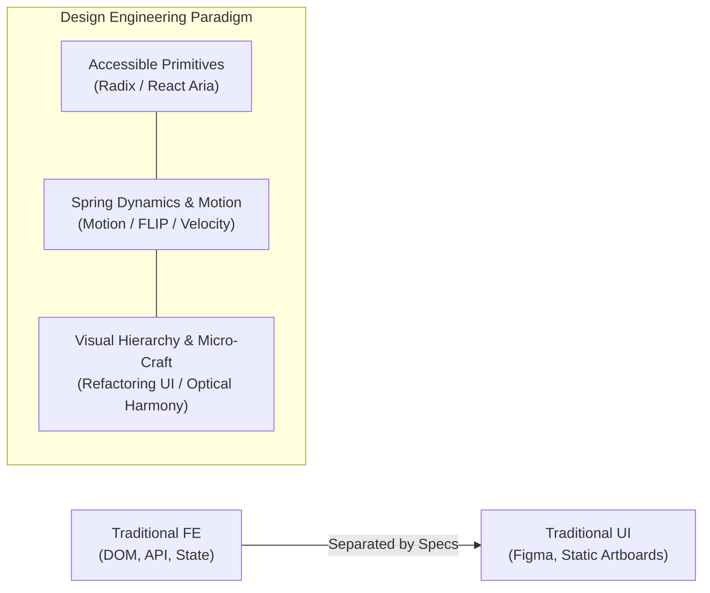
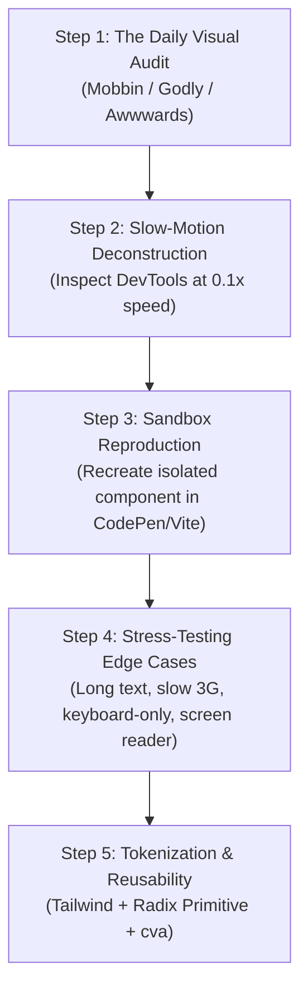

# Deconstructing the Craft: UI/UX, Design Engineering & Animation

> **Domain Dossier**: UI/UX Crafters, Animation Specialists & Design Engineers  
> **Anchored on**: Emil Kowalski, Paco Coursey, Rauno Freiberg, Josh Comeau, Steve Schoger, Adam Wathan, Stephen Haney (shadcn), Pedro Duarte, Matt Perry, Bruno Simon, Cheng Lou, and David Khourshid.  
> **Authoritative Sources**: *Refactoring UI*, *animations.dev*, *Laws of UX*, *Mobbin*, *Inclusive Components*, *Radix UI*, *Framer Motion*.

---

## 1. Core Mental Models & Philosophy

### 1.1 The Design Engineer Identity: The Convergence of Feel, Physics, and Code
In conventional development pipelines, a chasm exists between designers (who work in static artboards or time-based video prototypes) and frontend engineers (who translate visual specs into DOM elements and business logic). The **Design Engineer** dissolves this boundary:

- **Thinking in Interactive Time vs. Static States**: A designer produces screen $A$ and screen $B$. A design engineer designs the continuous vector space between $A$ and $B$, including interruption states, gesture cancellations, and frame-budget limits.
- **Physics over Timers**: Traditional frontend engineers think in durations (`transition: all 300ms ease-in-out`). Design engineers think in physical parameters (mass $m$, tension/stiffness $k$, damping $\zeta$). Objects do not have arbitrary stopwatch durations; they possess mass and respond to force and velocity.
- **The "Invisible Details" Doctrine (Rauno Freiberg)**: Great design is experienced subconsciously. When a user interacts with an element, the interface must exhibit spatial persistence, tactile responsiveness, and environmental coherence. If an animation calls attention to itself, it has failed. The goal is friction removal, sensory confirmation, and delight through effortless predictability.
- **Code Ownership vs. Dependency Black-Boxes (The `shadcn` Philosophy)**: Instead of treating UI libraries as opaque npm packages that dictate styling and lock developers into brittle abstraction layers, modern craft treats components as living source code within your repository. You build upon unstyled, headless accessible primitives (Radix, React Aria) styled with utility engines (Tailwind CSS) so you retain total control over the DOM, tokens, and animations.



---

### 1.2 The Hierarchy of Craft: From Functional to "Expensive"
A design engineer evaluates every component against four progressive thresholds:

1. **Accessibility & Semantics (The Foundation)**: Correct keyboard navigation, ARIA roles, focus traps, focus visibility, contrast compliance, and screen-reader announcements (Pedro Duarte, Heydon Pickering).
2. **Deterministic State Modeling (The Architecture)**: Eliminating impossible UI states through finite state machines. No dual-loading bugs, no overlapping modal collisions, no orphaned spinners (David Khourshid).
3. **Tactical Hierarchy & Ergonomics (The Presentation)**: Layout rhythm, optical alignment, spacing systems, and contrast balance without relying on heavy borders (Steve Schoger, Adam Wathan).
4. **Sensory & Physical Polish (The Craft)**: Spring-based interruption handling, gesture velocity inheritance, nested corner radii, micro-haptics, and subtle audio feedback (Emil Kowalski, Paco Coursey, Rauno Freiberg).

---

## 2. Essential Quotes & Vocabulary

### 2.1 Legendary Quotes & Principles
> *"Details aren't just details; they make the product. Most UI isn't bad because of bad ideas; it's bad because the micro-interactions were abandoned at 80% completion."*  
> — **Rauno Freiberg**

> *"Animations are not decorations; they are spatial proofs. They explain to the user's visual cortex where an object came from, where it lives, and where it went."*  
> — **Emil Kowalski**

> *"You don't need more borders. You need better contrast, consistent spacing, and intentional typographic hierarchy. Give elements breathing room and let the whitespace define the grouping."*  
> — **Steve Schoger & Adam Wathan (*Refactoring UI*)**

> *"Software can be fast in milliseconds, but feel sluggish. Or it can take 300 milliseconds, but feel instantaneous because of immediate visual acknowledgement and optimistic updates."*  
> — **Paco Coursey**

> *"If you animate with CSS durations and cubic-beziers, an interrupted gesture feels like hitting a brick wall. When you animate with springs, interruption is simply an injection of new velocity into an existing differential equation."*  
> — **Cheng Lou**

---

### 2.2 The Design Engineering Lexicon

#### Physics & Motion
- **Stiffness ($k$ / Tension)**: The rigidity of the virtual spring. Higher values generate faster acceleration toward the target.
- **Damping ($\zeta$ / Friction)**: The resistance applied to the spring motion. 
  - $\zeta < 1.0$: *Underdamped* (oscillates/bounces past the target).
  - $\zeta = 1.0$: *Critically Damped* (returns to equilibrium the fastest possible time without overshoot).
  - $\zeta > 1.0$: *Overdamped* (sluggish, no overshoot).
- **Mass ($m$)**: The inertia of the moving element. Heavier mass accelerates slower and carries more momentum.
- **Rest Delta / Velocity Tolerance**: The threshold at which the spring simulation ceases calculations and snaps to the final pixel coordinate to prevent infinite micro-computations and GPU battery drain.
- **FLIP Technique (First, Last, Invert, Play)**: A high-performance animation strategy coined by Paul Lewis: record the element's start rect (First), compute its end rect (Last), invert the delta via `transform: translate(dx, dy) scale(...)` (Invert), and animate the transform back to zero (Play) on the compositor thread.
- **Layout Projection**: Hardware-accelerated FLIP implementation (as in Framer Motion) that animates CSS layout changes using GPU-accelerated inverted matrix transforms rather than re-triggering browser layout/reflow passes.
- **Velocity Inheritance**: Passing touch or mouse swipe momentum directly into a spring when releasing a dragged element (e.g., bottom drawers like Vaul).

#### Optical Craft & Hierarchy
- **Nested Corner Radius Law**: To maintain concentric harmony between a parent container and a nested child, the inner radius must match:
  $$R_{\text{inner}} = R_{\text{outer}} - \text{Padding}$$
  If $R_{\text{outer}} \le \text{Padding}$, $R_{\text{inner}}$ must be $0$ or minimal.
- **Optical Center vs. Geometric Center**: The centroid of visual mass differs from bounding-box center. For instance, a triangle (Play icon) has visual mass skewed to the left; placing it in the geometric center of a circular button makes it look off-center. It must be nudged horizontally by $\approx 1-2\text{px}$.
- **Tinted Grays**: Never use dead neutral grays (`#808080` / `hsl(0, 0%, 50%)`). Always tint your grays with 2–5% saturation of your brand or background hue (e.g., cool slate blue-gray or warm stone gray) to create visual temperature and natural depth.
- **De-emphasizing Borders**: Replacing structural lines with elevation, subtle background fills, or 1px inner shadows (`box-shadow: inset 0 1px 0 0 rgba(255,255,255,0.05)`).
- **Dark Mode Elevation vs. Shadows**: In light mode, drop shadows communicate elevation ($Z$-axis). In dark mode, drop shadows are virtually invisible against dark backgrounds; elevation must be expressed via **surface luminance** (lighter backgrounds for higher surfaces) and subtle rim-lighting (`ring-1 ring-white/10`).

#### Ergonomics & UX Laws
- **Doherty Threshold**: User productivity spikes when computer response time is below 400ms. Interfaces must provide immediate sensory feedback ($<100\text{ms}$) even if backend computation continues in the background.
- **Fitts's Law**: The time required to rapidly move to a target area is a function of the ratio between the distance to the target and the width of the target. Corners and screen edges have infinite clickable width; small buttons placed far away create high cognitive friction.
- **Hick's Law**: The time it takes to make a decision increases logarithmically with the number and complexity of choices. Solved via progressive disclosure and command bars (`cmdk`).
- **Jakob's Law**: Users spend most of their time on other sites. Interfaces should respect platform-standard interaction heuristics (esc to close, tab to cycle focus, command+k for search) rather than reinventing navigation paradigms.

---

## 3. Concrete Tips & Tricks: The Crafter's Cheat Sheet

### 3.1 Motion Physics & Micro-Interactions

#### 1. The Universal Snappy Spring Configuration
For modal entries, tooltips, dropdowns, and button popovers, discard `duration: 0.3s ease-out`. Use a critically damped or slightly underdamped spring:
```typescript
// Framer Motion / Motion One configuration
const snappySpring = {
  type: "spring",
  stiffness: 400,
  damping: 30, // Crisp snap, zero annoying oscillation
  mass: 0.8
};

const gentleSpring = {
  type: "spring",
  stiffness: 200,
  damping: 24, // Silky page or drawer transition
  mass: 1.0
};
```

#### 2. Micro-Scale Interactions for Tactile Feel
Never leave buttons completely static. Apply a 3-tier micro-scale state:
- Default: `scale(1)`
- Hover: `scale(1.02)` (or `scale(1.03)` with a soft spring)
- Active / Pressed: `scale(0.97)` with `transition: transform 50ms ease-out`
```css
.tactile-button {
  transition: transform 100ms cubic-bezier(0.16, 1, 0.3, 1), box-shadow 100ms ease;
}
.tactile-button:hover {
  transform: translateY(-1px) scale(1.015);
}
.tactile-button:active {
  transform: translateY(1px) scale(0.975);
}
```

#### 3. Stagger Deltas
When animating a list or a menu open, never animate all items simultaneously, and never use large delays that force the user to wait:
- Item count: $\le 10$ items.
- Stagger delay: **$25\text{ms}$ to $40\text{ms}$** per child.
- Directional Stagger: Animate out in reverse order ($N \to 1$) so the exit feels coordinated and exits faster than it entered.

#### 4. The Exit Animation Rule
**Exit animations must always be 30–50% faster than entry animations.**  
When an element enters, the user is discovering it; when it leaves, the user has already dismissed it and wants it out of their way.
- Entry: $250\text{ms} - 320\text{ms}$ (or spring stiffness 350).
- Exit: $150\text{ms} - 200\text{ms}$ with `ease-in` acceleration (or spring stiffness 500, damping 40).

---

### 3.2 Visual Hierarchy & Layout Secrets (Refactoring UI Principles)

#### 1. Establish Hierarchy without Borders
Developers habitually separate sections with `<hr />` or `border-t border-gray-200`. Instead:
1. Increase spacing between distant elements (e.g., `gap-8` instead of `gap-4` with a border).
2. Use subtle background contrast (e.g., `#ffffff` card on `#f8fafc` canvas, or `#18181b` card on `#09090b` canvas).
3. Vary typographic weight and color: Primary heading (`font-semibold text-zinc-900`), Secondary label (`font-medium text-zinc-500 text-xs tracking-wider uppercase`).

```
[BAD: Border Heavy]               [GOOD: Contrast & Spacing]
┌─────────────────────────┐       ┌─────────────────────────┐
│ User Details            │       │ User Details            │
├─────────────────────────┤       │                         │
│ Name: Alex Rivera       │       │ Alex Rivera             │
├─────────────────────────┤       │ Engineering Lead        │
│ Role: Engineer          │       │                         │
└─────────────────────────┘       │ 14 projects completed   │
                                  └─────────────────────────┘
```

#### 2. The Golden Ratio of Spacing Scales
Never use arbitrary pixel margins (`margin: 13px`). Stick rigorously to a multi-step 4px/8px scale:
- `2px` (`0.5`), `4px` (`1`), `8px` (`2`), `12px` (`3`), `16px` (`4`), `24px` (`6`), `32px` (`8`), `48px` (`12`), `64px` (`16`).
- **Rule of Thumb**: Internal padding of an element should be strictly smaller than the margin separating it from its siblings.

#### 3. Optical Alignment of Glyphs and Numbers
- **Tabular Figures for Dynamic Data**: When rendering timers, counters, stock tickers, or financial balances, normal variable-width fonts jitter horizontally on digit changes. Always apply:
  ```css
  font-feature-settings: "tnum";
  font-variant-numeric: tabular-nums;
  ```
- **Optical Play Button Centering**:
  ```css
  .play-icon {
    /* Offset the geometric imbalance of a right-pointing triangle */
    transform: translateX(1.5px);
  }
  ```

#### 4. Dark Mode Luminance Stack
Do not invert light mode colors naively. Build a luminance ladder:
- Background (Base Canvas): `#09090b` (Zinc 950)
- Surface 1 (Cards, Tables): `#121215` (Zinc 900)
- Surface 2 (Hover states, Modals): `#1c1c21` (Zinc 800)
- Surface 3 (Active states, Popovers): `#27272a` (Zinc 700)
- Primary Text: `#f4f4f5` (Zinc 100) — *never `#ffffff` to avoid harsh optical glare*
- Secondary Text: `#a1a1aa` (Zinc 400)
- Borders: `rgba(255, 255, 255, 0.08)` (Subtle white translucency rather than solid gray)

---

### 3.3 Micro-Interactions & Component Craft

#### 1. Command Palette (`cmdk` pattern by Paco Coursey)
- Instant open on `Cmd+K` / `Ctrl+K`.
- Background overlay with subtle blur: `backdrop-filter: blur(8px)`.
- Input must auto-focus instantly with zero layout shift.
- List filtering must be synchronous, client-side, and fuzzy-matched (<1ms render).
- Keyboard selection loop: Arrow keys wrap from last to first item.

#### 2. Stacked Toast Notification Engine (`sonner` pattern by Emil Kowalski)
- When multiple toasts trigger, do not stack them down the viewport covering the UI.
- Stack them in a compact deck with simulated depth:
  - Card 0 (front): `scale(1) translateY(0px)`
  - Card 1: `scale(0.95) translateY(14px) opacity(0.9)`
  - Card 2: `scale(0.90) translateY(28px) opacity(0.7)`
- Hovering over the toast deck expands them dynamically using FLIP layout animation so the user can inspect or dismiss individually.

#### 3. Sound Synthesis for Micro-Affordances (Josh Comeau / Rauno Freiberg)
Do not download heavy MP3 assets for UI sounds. Use the native Web Audio API to synthesize micro-pops (<20ms) directly in memory:
```typescript
class MicroAudio {
  private ctx: AudioContext | null = null;

  playClick() {
    if (!this.ctx) this.ctx = new (window.AudioContext || (window as any).webkitAudioContext)();
    const osc = this.ctx.createOscillator();
    const gain = this.ctx.createGain();

    osc.type = "sine";
    // Rapid pitch drop creates a subtle mechanical 'pop'
    osc.frequency.setValueAtTime(800, this.ctx.currentTime);
    osc.frequency.exponentialRampToValueAtTime(120, this.ctx.currentTime + 0.035);

    gain.gain.setValueAtTime(0.08, this.ctx.currentTime);
    gain.gain.exponentialRampToValueAtTime(0.001, this.ctx.currentTime + 0.035);

    osc.connect(gain);
    gain.connect(this.ctx.destination);
    osc.start();
    osc.stop(this.ctx.currentTime + 0.035);
  }
}
```

---

## 4. How to Think and Work Like Them as a Beginner



### 4.1 The Five-Step Daily Discipline
1. **The Visual Audit (15 mins/day)**:
   - Study 1 interaction flow on **Mobbin** or **Godly**.
   - Don't just look at the colors; ask: *How did the sheet dismiss? What happened to the background? What was the cursor position? Did the button trigger before or after network response?*
2. **Slow-Motion Inspection**:
   - Open Chrome DevTools $\to$ More Tools $\to$ **Animations**.
   - Slow down animations to **10% speed** or **25% speed**.
   - Observe the spring curve: is it scaling from the center or expanding from the click origin? Does the text cross-fade or slide?
3. **Isolate and Rebuild**:
   - Never try to learn craft inside a monolithic enterprise codebase. Open a standalone Vite/Next.js playground or CodePen.
   - Recreate the single interaction (e.g., a fluid pill tab indicator, an expandable card, a notification swipe).
4. **The "Five Polish Checks"**:
   Before calling any component "done", verify:
   - **Interruption Check**: If I click/drag rapidly mid-animation, does it glitch, jump, or smoothly redirect its velocity?
   - **Hit Area Check**: Is the touch target at least $44 \times 44\text{px}$ even if the visual icon is only $16 \times 16\text{px}$? (Using negative margins or pseudo-elements).
   - **Keyboard & Focus Check**: Can I operate every feature with `Tab`, `Space`, `Enter`, and `Escape` with an accessible `ring-2` focus indicator?
   - **Content Extremes Check**: What happens if the username is 60 characters? What if the network request fails? What if the list is empty?
   - **Concentric Geometry Check**: Are the inner corners properly calculated with $R_{\text{inner}} = R_{\text{outer}} - \text{padding}$?
5. **Component Ergonomics & Architecture**:
   - Use **Radix Primitives** for state and accessibility.
   - Use **Tailwind CSS** for tokens and layout.
   - Use **Class Variance Authority (`cva`)** for variant management.
   - Use **Framer Motion** or **Motion One** for spring transitions.

---

## 5. Hands-on Test Exercise: The Fluid Action Deck

To master and prove the craft of Kowalski, Coursey, Rauno, and Schoger, complete this comprehensive implementation challenge.

### 5.1 Project Specification: "The Dynamic Floating Action Deck"
Build a standalone production-grade React + Tailwind + Motion component that serves as a multi-action floating control widget.

#### Core Functional Requirements:
1. **The Resting Trigger (Pill)**:
   - Floats anchored at the bottom-center of the viewport.
   - Contains an icon, an active status dot, and an action counter with `tabular-nums`.
   - On hover: tactile scale (`scale(1.02)`), subtle elevation increase.
   - On active press: tactile depression (`scale(0.97)`), micro-audio click synthesis.
2. **The Morphing Expansion (FLIP Transition)**:
   - Clicking the pill does *not* unmount and replace it with a modal. The pill **morphs fluidly** into an expanded command deck card using layout projection (`layoutId` or FLIP).
   - The transition must use a physical spring (`stiffness: 380, damping: 28`).
   - Inner content fades and staggers in with a 25ms delay per section.
3. **The Interactive Action List (`cmdk` style)**:
   - Full keyboard navigation: `Up`/`Down` arrow keys highlight items with a sliding background pill indicator (shared layout spring).
   - `Enter` triggers the action; `Escape` snaps the card back down into the resting pill.
   - Search input at the top with immediate client-side filtering.
4. **Gesture-Driven Dismissal (Swipe Physics)**:
   - Dragging down on the card tracks the cursor/finger 1:1.
   - If released with high downward velocity or dragged past the threshold ($>80\text{px}$), it collapses back to the pill, inheriting velocity.
   - If released below the threshold, it snaps back open with a crisp spring oscillation.
5. **Dark Mode & Optical Refinements**:
   - Strict adherence to the Nested Corner Radius Law ($R_{\text{card}} = 24\text{px}, \text{padding} = 12\text{px} \implies R_{\text{inner}} = 12\text{px}$).
   - Tinted dark palette (`zinc-900`/`zinc-950`), translucent border highlight (`ring-1 ring-white/10`), no muddy pure black.

---

### 5.2 Implementation Blueprint (Code Template)

```tsx
import React, { useState, useRef, useEffect } from "react";
import { motion, AnimatePresence, LayoutGroup } from "framer-motion";

interface ActionItem {
  id: string;
  label: string;
  shortcut: string;
  category: string;
}

const ACTIONS: ActionItem[] = [
  { id: "1", label: "Create new document", shortcut: "⌘N", category: "Actions" },
  { id: "2", label: "Copy invite link", shortcut: "⌘C", category: "Sharing" },
  { id: "3", label: "Switch dark mode", shortcut: "⌘D", category: "Preferences" },
  { id: "4", label: "Open settings", shortcut: "⌘,", category: "Preferences" },
];

export function FluidActionDeck() {
  const [isOpen, setIsOpen] = useState(false);
  const [query, setQuery] = useState("");
  const [selectedIndex, setSelectedIndex] = useState(0);

  const filtered = ACTIONS.filter((a) =>
    a.label.toLowerCase().includes(query.toLowerCase())
  );

  // Keyboard navigation
  useEffect(() => {
    function handleKeyDown(e: KeyboardEvent) {
      if (e.key === "k" && (e.metaKey || e.ctrlKey)) {
        e.preventDefault();
        setIsOpen((prev) => !prev);
      }
      if (!isOpen) return;

      if (e.key === "Escape") {
        setIsOpen(false);
      } else if (e.key === "ArrowDown") {
        e.preventDefault();
        setSelectedIndex((prev) => (prev + 1) % filtered.length);
      } else if (e.key === "ArrowUp") {
        e.preventDefault();
        setSelectedIndex((prev) => (prev - 1 + filtered.length) % filtered.length);
      }
    }
    window.addEventListener("keydown", handleKeyDown);
    return () => window.removeEventListener("keydown", handleKeyDown);
  }, [isOpen, filtered.length]);

  return (
    <div className="fixed inset-x-0 bottom-8 flex justify-center items-end pointer-events-none z-50">
      <LayoutGroup>
        {!isOpen ? (
          <motion.button
            layoutId="action-deck-container"
            onClick={() => setIsOpen(true)}
            className="pointer-events-auto flex items-center gap-3 px-4 py-2.5 bg-zinc-900 border border-zinc-700/60 rounded-full shadow-2xl text-zinc-100 hover:scale-[1.02] active:scale-[0.97] transition-transform select-none"
            transition={{ type: "spring", stiffness: 400, damping: 30 }}
          >
            <span className="w-2 h-2 rounded-full bg-emerald-500 animate-pulse" />
            <span className="text-xs font-medium tracking-wide">Quick Actions</span>
            <kbd className="px-1.5 py-0.5 text-[10px] bg-zinc-800 border border-zinc-700 rounded text-zinc-400 font-mono">
              ⌘K
            </kbd>
          </motion.button>
        ) : (
          <motion.div
            layoutId="action-deck-container"
            drag="y"
            dragConstraints={{ top: 0, bottom: 0 }}
            dragElastic={{ top: 0.05, bottom: 0.6 }}
            onDragEnd={(_, info) => {
              if (info.offset.y > 80 || info.velocity.y > 400) {
                setIsOpen(false);
              }
            }}
            className="pointer-events-auto w-full max-w-md bg-zinc-900 border border-zinc-700/60 rounded-[24px] p-3 shadow-2xl text-zinc-100 flex flex-col gap-2 overflow-hidden"
            transition={{ type: "spring", stiffness: 380, damping: 28 }}
          >
            {/* Header & Search */}
            <div className="flex items-center gap-2 px-2 py-1 border-b border-zinc-800 pb-2">
              <input
                autoFocus
                value={query}
                onChange={(e) => {
                  setQuery(e.target.value);
                  setSelectedIndex(0);
                }}
                placeholder="Type a command or search..."
                className="w-full bg-transparent text-sm text-zinc-100 placeholder-zinc-500 focus:outline-none"
              />
              <span className="text-[10px] font-mono text-zinc-500 uppercase px-1.5 py-0.5 rounded bg-zinc-800">
                ESC to close
              </span>
            </div>

            {/* Action Items List */}
            <div className="flex flex-col gap-1 py-1 max-h-60 overflow-y-auto">
              {filtered.map((item, idx) => {
                const isSelected = idx === selectedIndex;
                return (
                  <div
                    key={item.id}
                    onMouseEnter={() => setSelectedIndex(idx)}
                    onClick={() => {
                      alert(`Executed: ${item.label}`);
                      setIsOpen(false);
                    }}
                    className="relative flex items-center justify-between px-3 py-2 rounded-[12px] text-xs cursor-pointer select-none"
                  >
                    {isSelected && (
                      <motion.div
                        layoutId="active-pill-highlight"
                        className="absolute inset-0 bg-zinc-800/80 rounded-[12px] -z-10"
                        transition={{ type: "spring", stiffness: 500, damping: 35 }}
                      />
                    )}
                    <span className={isSelected ? "text-zinc-100 font-medium" : "text-zinc-400"}>
                      {item.label}
                    </span>
                    <kbd className="text-[10px] font-mono text-zinc-500">{item.shortcut}</kbd>
                  </div>
                );
              })}
            </div>
          </motion.div>
        )}
      </LayoutGroup>
    </div>
  );
}
```

---

### 5.3 Master Evaluation Rubric

| Category | Criteria & Requirements | Weight |
| :--- | :--- | :--- |
| **Motion Physics & FLIP** | Pill-to-modal transition morphs seamlessly with zero layout jump; spring parameters avoid unnatural robotic ease curves; dragging downwards respects inertia and velocity. | 25 pts |
| **Tactile Micro-Interactions** | Button exhibits 3-tier scaling (default, hover, active); active state provides instant visual/audio feedback; active list highlight floats via shared spring layout. | 20 pts |
| **Typographic & Visual Craft** | Strictly follows the Nested Corner Radius Law ($R_{\text{inner}} = R_{\text{outer}} - p$); uses tinted dark grays (`#18181b`/`#09090b`) with translucent rim lighting (`ring-1 ring-white/10`); numbers use tabular figures. | 20 pts |
| **Keyboard & Accessibility** | Full keyboard parity (`Cmd+K`, `ArrowUp`, `ArrowDown`, `Enter`, `Escape`); proper focus trap when open; `aria-expanded` and role definitions valid. | 20 pts |
| **Defensive Edge Handling** | Component handles empty search results cleanly without layout collapse; handles long strings without overflow; gesture interruption does not desync internal open/closed state. | 15 pts |
| **Total** | **Mastery Threshold: $\ge 90$ Points** | **100 pts** |

---

## 6. Synthesis & The Design Engineer's Roadmap

To transition from an ordinary frontend developer into a world-class design engineer:
1. **Stop thinking in page views; start thinking in continuous spatial topologies.**
2. **Replace durations with spring physics.**
3. **Replace arbitrary borders with typographic scale and luminance tiers.**
4. **Master headless accessibility primitives before writing custom UI components.**
5. **Sweat the invisible details: optical alignment, tabular numbers, nested radii, and micro-haptics.**
